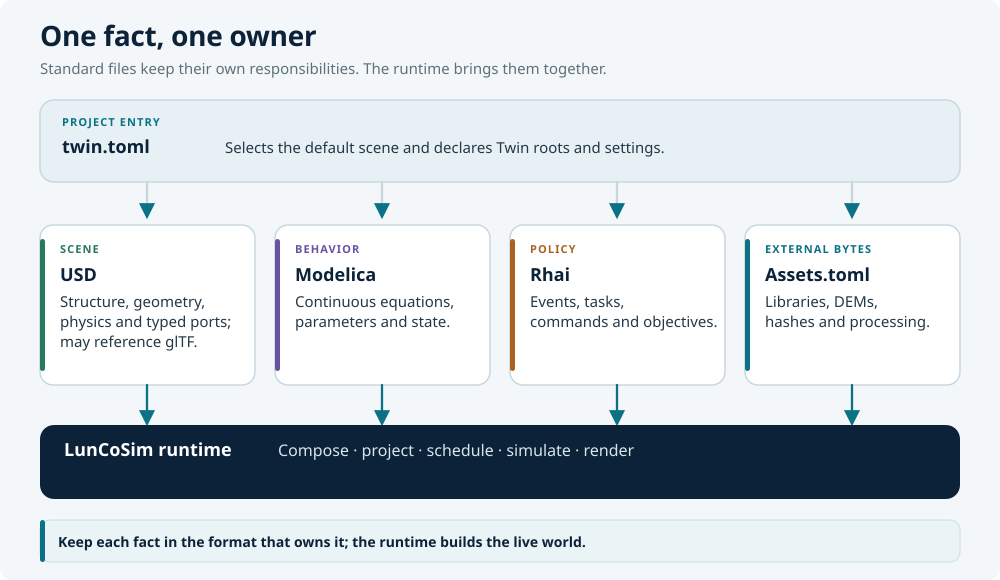
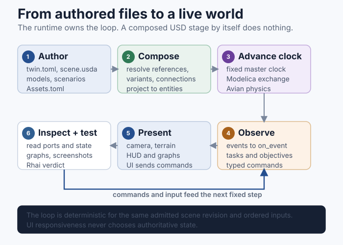

# How it fits together

LunCoSim separates **what the system is** from **how it behaves** and **what
the operation does**. Each layer has a standard format and a clear owner.



## The layers

| Layer | Owns | Does not own |
|---|---|---|
| `twin.toml` | Project identity, entry scene, search roots, settings | Physical equations |
| USD | Parts, transforms, variants, materials, physics schemas, typed ports, connections | Modelica state integration |
| Modelica | Continuous equations, energy/state balance, solved outputs | Scene traversal or mission sequencing |
| Rhai | Events, commands, sequencing, authored test verdicts | Continuous dynamics |
| `Assets.toml` | Declarations for external bytes: libraries, rasters, models, fonts | Scene structure or runtime state |
| Rust / Avian | Generic projection, physics, scheduling, and engine mechanics | A particular rover, mission, or lesson |

The important rule is **one fact, one owner**. A wheel's position belongs in
USD. A motor's torque curve belongs in Modelica. A waypoint mission belongs in
Rhai. A downloaded terrain DEM belongs in `Assets.toml` and the asset cache.

## Runtime flow



1. The Twin opens. `twin.toml` selects the default USD scene and the Modelica
   and SysML source roots.
2. USD composition resolves sublayers, references, payloads, and variants into
   one composed stage.
3. The runtime projects the composed stage into the live entity world: scene
   hierarchy, transforms, physics bodies, colliders, lights, cameras, and
   program attachments.
4. Modelica participants are admitted. The fixed master clock advances them;
   outputs cross `SimConnection`s at declared communication points.
5. Physics applies forces and integrates the rigid bodies. Rhai scenarios
   receive events and issue typed commands through the same command/query API
   as the UI and HTTP API.
6. The UI renders the current state. The UI does not mutate domain state
   directly; it sends commands to the owning layer.

A composed USD stage by itself is inert. It does not launch Modelica, run Rhai,
apply physics, or render. The runtime is what projects the authored documents
into a live world.

## A rover, layer by layer

| Question | File | What it contains |
|---|---|---|
| Where is the chassis, where are the wheels, how do they attach? | USD | `Xform` hierarchy, references, `UsdPhysics` bodies and joints |
| What is the controller law? | Modelica | `.mo` equations for drive, steering, motor, or thermal behavior |
| What should the mission do? | Rhai | `on_start`, `task`, `on_event`, waypoints, commands, verdicts |
| Where does the terrain DEM come from? | `Assets.toml` | URL, `dest`, optional `sha256` and processing recipe |
| Which scene opens? | `twin.toml` | `[usd] default_scene` |

A complete drive loop can look like this:

```text
USD                  Modelica                 Physics
wheels + joints  →   drive law + motor   →   forces + motion
      ↑                                           │
      └──────────── typed USD connections ─────────┘
                           │
                        Rhai policy
                 mission events and commands
```

## What stays out of each layer

- Do not put mission decisions or timers in Modelica.
- Do not integrate physics or reimplement a controller in Rhai.
- Do not encode equations in USD attributes.
- Do not add a Rust special case for a specific rover, lesson, or asset.
- Do not hand-edit generated or cached assets; author the source and let the
  owning pipeline produce the result.

Read the format pages next:

- [Twin](twin.md) — the project folder
- [twin.toml](twin-toml.md) — the manifest
- [USD](usd.md) — the scene and topology
- [Modelica](modelica.md) — continuous behavior
- [Rhai](rhai.md) — scenario policy
- [Assets.toml](assets-toml.md) — external assets
