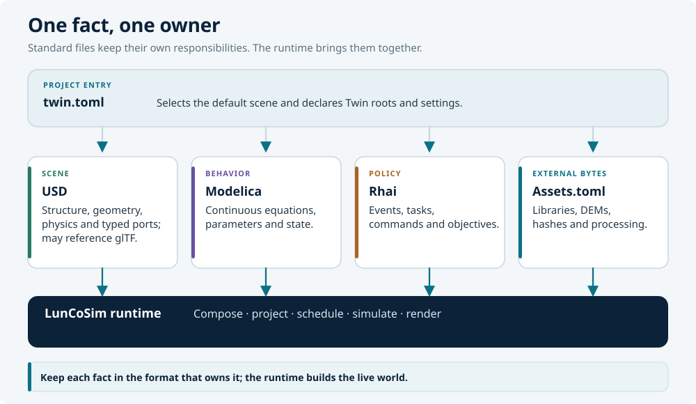
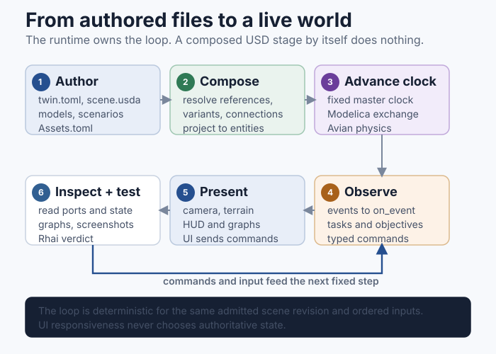

# How it fits together

LunCoSim separates **what the system is** from **how it behaves** and **what
the operation does**. Each layer has a standard format and a clear owner. The
runtime composes those layers into one live world and gives every participant
the same clock, identity, and command surface.

<figure>
<a href="../../assets/images/luncosim-layers.svg"></a>
<figcaption>The authored layers and the runtime. The arrows indicate ownership
and projection, not a one-way build pipeline.</figcaption>
</figure>

## The layers

| Layer | Owns | Does not own |
|---|---|---|
| `twin.toml` | Project identity, entry scene, search roots, settings | Physical equations |
| USD | Parts, transforms, variants, materials, physics schemas, typed ports, connections | Modelica state integration |
| Modelica | Continuous equations, energy and state balance, solved outputs | Scene traversal or mission sequencing |
| Rhai | Events, commands, sequencing, authored test verdicts | Continuous dynamics |
| `Assets.toml` | Declarations for external bytes: libraries, rasters, models, fonts | Scene structure or runtime state |
| Rust / Avian | Generic projection, physics, scheduling, and engine mechanics | A particular rover, mission, or lesson |

The important rule is **one fact, one owner**. A wheel's position belongs in
USD. A motor's torque curve belongs in Modelica. A waypoint mission belongs in
Rhai. A downloaded terrain DEM belongs in `Assets.toml` and the asset cache.

## Runtime flow

<figure>
<a href="../../assets/images/runtime-loop.svg"></a>
<figcaption>The runtime loop. The UI observes and commands; it does not own
domain state.</figcaption>
</figure>

The sequence is easier to understand as a series of boundaries than as a
pipeline:

1. The Twin opens. `twin.toml` selects the default USD scene and the Modelica
   and SysML source roots.
2. USD composition resolves sublayers, references, payloads, and variants into
   one composed stage.
3. The runtime projects the composed stage into the live entity world: scene
   hierarchy, transforms, physics bodies, colliders, lights, cameras, and
   program attachments.
4. Modelica participants are admitted. The fixed master clock advances them;
   outputs cross `SimConnection`s at declared communication points.
5. Physics applies forces and integrates the rigid bodies. Rhai scenarios
   receive events and issue typed commands through the same command and query
   API as the UI and HTTP API.
6. The UI renders the current state. The UI does not mutate domain state
   directly; it sends commands to the owning layer.

A composed USD stage by itself is inert. It does not launch Modelica, run Rhai,
apply physics, or render. The runtime is what projects the authored documents
into a live world.

## A rover, layer by layer

A single vehicle demonstrates the division better than an abstract diagram.
Consider a rover with a chassis, six wheels, a drive controller, and a
waypoint mission.

| Question | File | What it contains |
|---|---|---|
| Where is the chassis, where are the wheels, how do they attach? | USD | `Xform` hierarchy, references, `UsdPhysics` bodies and joints |
| What is the controller law? | Modelica | `.mo` equations for drive, steering, motor, or thermal behavior |
| What should the mission do? | Rhai | `task`, `mission`, `on_event`, waypoints, commands, verdicts |
| Where does the terrain DEM come from? | `Assets.toml` | URL, `dest`, optional `sha256` and processing recipe |
| Which scene opens? | `twin.toml` | `[usd] default_scene` |

A complete drive loop can look like this:

```text
USD                  Modelica                 Physics
wheels + joints  →   drive law + motor   →   forces + motion
      ↑                                           │
      └──────────── typed USD connections ─────────┘
                           │
                        Rhai policy
                 mission events and commands
```

The arrows are not a dataflow that the author programs. They are the
consequence of the authored topology. The wheel joint is a USD fact. The motor
equation is a Modelica fact. The connection is a USD fact. The runtime derives
the scheduling order from the composed graph.

## Why the boundaries matter

The boundaries are not bureaucratic. Each one prevents a class of defect.

**A single clock.** Modelica participants, physics, and Rhai tasks advance on
the same simulation timeline. If a script kept its own timer, two parts of the
mission would disagree about when "ten seconds" had passed.

**A single identity.** A prim path, an entity id, and a port owner are related
but not interchangeable. The runtime keeps the mapping explicit so a command
cannot accidentally target a different rover after a scene reload.

**A single authority.** Selection, camera control, and input authority are
separate. A script that holds a vehicle and a user who clicks **Take control**
are resolved by the same authority rules, not by whichever system wrote last.

**A single evidence trail.** A scene test runs the authored observer against
the production runtime. A parse check runs the same loaders without a window.
A live lint sees the composed stage. Each layer reports what it can see and
does not pretend to see more.

## What stays out of each layer

- Do not put mission decisions or timers in Modelica.
- Do not integrate physics or reimplement a controller in Rhai.
- Do not encode equations in USD attributes.
- Do not add a Rust special case for a specific rover, lesson, or asset.
- Do not hand-edit generated or cached assets; author the source and let the
  owning pipeline produce the result.
- Do not duplicate a route, a limit, or a tuning constant in a lesson when the
  value is already authored in USD or Modelica.

## A worked boundary decision

Suppose a rover tips over on a slope. There are several tempting places to
"fix" the behavior:

- Lower the center of mass in the USD asset. This is a physical change and
  belongs in USD if the design is wrong.
- Change the suspension spring in the USD suspension schema or the joint
  drive. This is also a physical change.
- Reduce the speed in the Rhai mission. This is a policy change and belongs in
  Rhai if the mission should approach the slope more slowly.
- Loosen the test's tilt limit. This changes the evidence, not the system. It
  is appropriate only when the original limit was wrong and the new limit is
  justified.

The correct fix depends on the question being asked. The layer boundaries do
not choose the answer; they make it clear which answer is being changed.

## Read the format chapters next

- [Twins](twins.md) — the project folder and lifecycle
- [Formats](formats.md) — a side-by-side comparison
- [USD](../usd/index.md) — the scene and topology
- [Modelica](../modelica/index.md) — continuous behavior
- [Rhai](../rhai/index.md) — scenario policy
- [twin.toml](../reference/twin-toml.md) — the manifest
- [Assets.toml](../reference/assets-toml.md) — external assets
