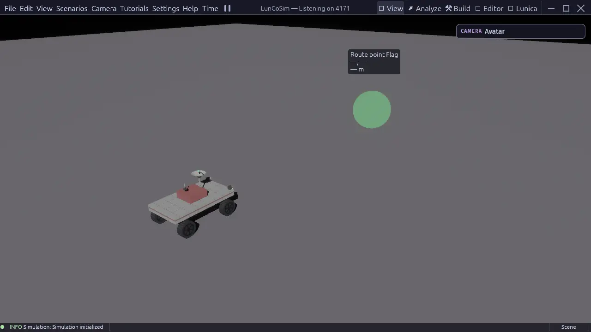
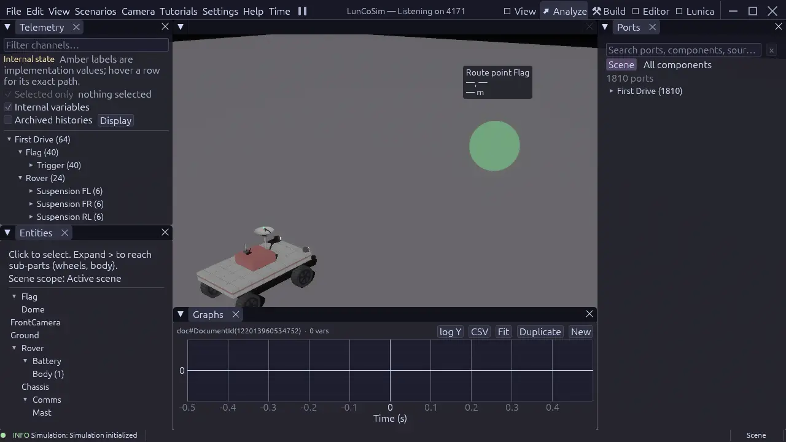
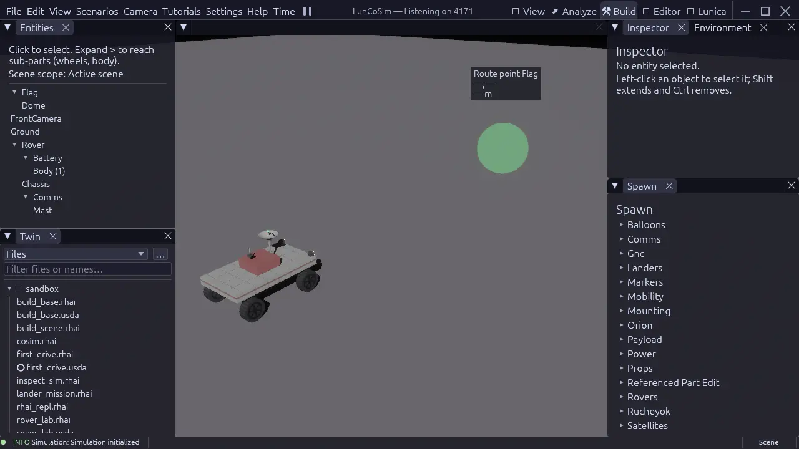
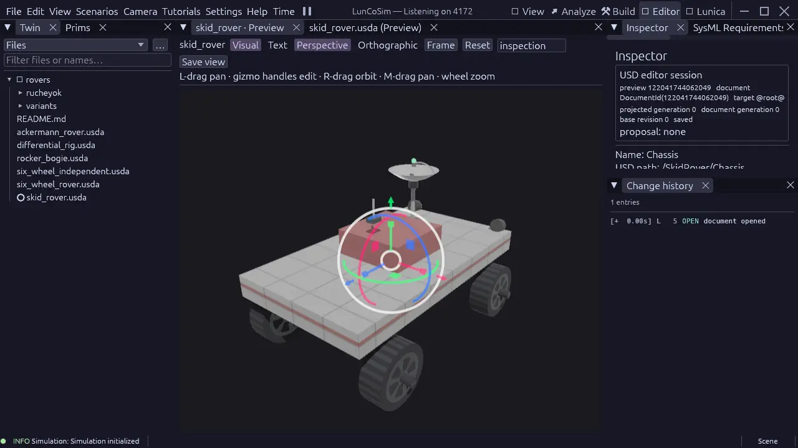
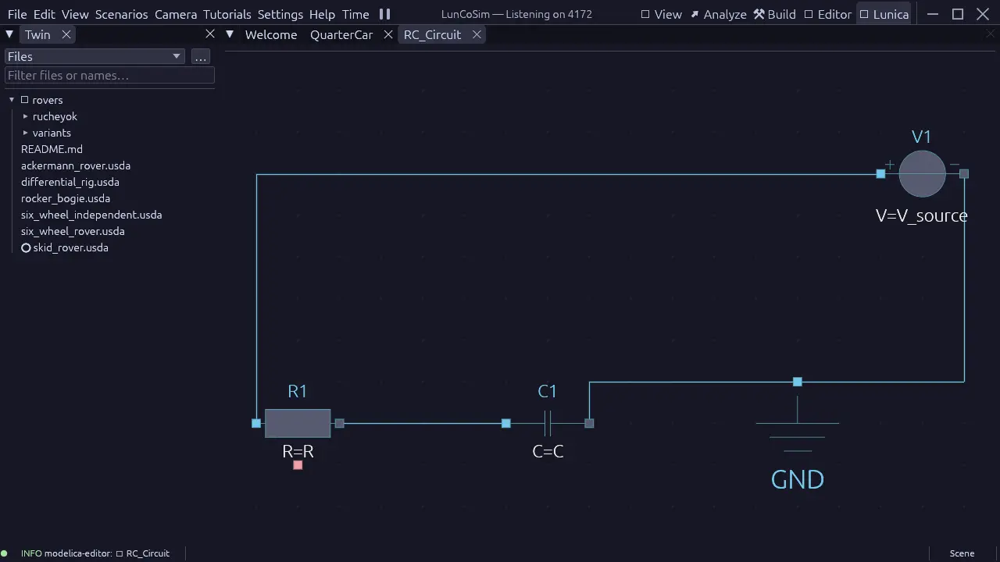

# Perspectives

A perspective is a task layout over the same Twin. Switching from **View** to
**Build**, **Analyze**, **Editor**, or **∿ Lunica** does not reload the scene,
reset the simulation, or duplicate your project. It changes which tools are
docked and what the center of the window is for.

The title bar pins the five main tasks. **View → Perspectives** lists those
tasks plus specialist presets such as **Terrain** and **Keybindings**, and any
tasks contributed by the Twin.

- **◉ View**

    Operate and present the running Twin.

    [Open View](#view-operate-the-mission)

- **↗ Analyze**

    Compare signals and inspect live port values.

    [Open Analyze](#analyze-read-the-signals)

- **⚒ Build**

    Compose and tune the live scene.

    [Open Build](#build-compose-the-live-scene)

- **✎ Editor**

    Edit one explicit USD document in isolation.

    [Open Editor](#editor-edit-one-usd-document)

- **∿ Lunica**

    Develop, compile, and run Modelica models.

    [Open Lunica](#lunica-engineer-a-modelica-model)

- **↻ Switch layouts**

    Preserve the Twin, documents, and simulation.

    [Switch and recover](#switch-and-recover-a-layout)

**Analyze** is the built-in label for analytics work; there is no separate
Analytics tab.

## Switch and recover a layout

Select a title-bar tab, or choose **View → Perspectives** and pick a task.
Compact windows collapse the tabs into a picker. Switching perspectives
preserves the Twin and the simulation; layout changes stay with their task.
Switching does not start or stop the simulation; the title-bar transport and
simulation state remain global.

Open document tabs stay open when you switch, including documents with unsaved
edits. The active task and each task layout are remembered per Twin. A Twin can
declare its initial task with `default_perspective` in
[twin.toml](../reference/twin-toml.md); once you choose a task yourself, that
choice takes precedence when you reopen the Twin.

- **View → Reset Layout** reapplies the authored default for the current
  perspective.
- **Help → Perspective help** explains what the current perspective is for.
- The **View** menu also has task submenus (Build, Analyze, Editor, Lunica, and
  General) that open optional panels.
- The **Graphs** menu action switches to **Analyze** when that workflow is
  available.

A guided lesson can temporarily pin the perspective its steps rely on. When
the lesson completes or is skipped, normal perspective switching resumes.

## View: operate the mission

**View** gives the live scene the whole window. It is the perspective to use
when the task is to watch, drive, fly, or demonstrate rather than author.

The viewport keeps selection, control, and camera targets separate. Selecting
an object does not give you its controls, and moving the camera does not change
what is selected.

<figure class="shot">

<figcaption>The View perspective leaves the live scene full-window. Open optional
panels from View when you need them.</figcaption>
</figure>

To use it:

1. Open a scene or lesson and let the scene finish preparing.
2. Click an object to select it, or click an input endpoint to take control of
   a vehicle or mechanism. In a lesson, use the **Take control** action when
   the card offers it.
3. Drive with the displayed bindings. The lesson card and the active input map
   always show the keys configured on your machine.
4. Right-drag to orbit and scroll to zoom. The camera keeps its own target.
5. Use the transport controls or <kbd>P</kbd> to pause when you need to inspect
   a moment without stopping the app.

Release control with <kbd>G</kbd> when you are done; selecting another object
does not transfer control. Use View for operating and presenting a Twin. Switch
to Build when you need to add or edit scene objects, and to Analyze when you
need the signal data behind what you see.

## Analyze: read the signals

**Analyze** is the telemetry and plotting perspective. The live scene remains
in the center, **Telemetry** sits above **Entities** on the left, **Ports** is
on the right, and **Graphs** occupies the bottom dock.

<figure class="shot">

<figcaption>Analyze brings the live scene, Telemetry, Ports, and Graphs together.
Graphs records simulation samples, not rendered frames.</figcaption>
</figure>

To compare signals:

1. Switch to **Analyze**. If no scene is mounted, Graphs opens in the center.
2. Select an entity in **Entities**, or choose it in **Telemetry**, to narrow
   the channel list.
3. Check a channel, or drag it into the active plot in **Graphs**. Add more
   channels to the same plot to compare them on one time axis.
4. Use **Ports** to read current values and to write manual inputs while the
   model is running. Use the port's direction and kind: write inputs, read
   outputs.
5. Pause the simulation to inspect the latest sample. The graph keeps the
   samples it already recorded; it does not replay rendered frames.

Use **New** in the Graphs toolbar to open a separate plot with its own signal
set. If Graphs is hidden, use the **Graphs** menu or open the optional **View →
Analyze** panels. Graphs is the canonical analysis surface; the same data is
also available through the HTTP API when you need to script a check.

## Build: compose the live scene

**Build** is the scene-composition perspective. **Entities** sits above the
**Twin** file browser on the left, the live scene is in the center, and
**Inspector** and **Environment** sit above the **Spawn** palette on the right.

<figure class="shot">

<figcaption>Build places the scene tree, Twin files, Inspector, Environment, and
Spawn palette around the live scene.</figcaption>
</figure>

To assemble a scene:

1. Open the Twin or scene you want to edit. Build edits the live scene, so the
   simulation keeps running while you work.
2. Select an object in **Entities** to inspect it, or choose an assembly in the
   **Spawn** palette.
3. Place the new object, then adjust its transform and properties in
   **Inspector** or with the viewport transform gizmo.
4. Use **Environment** for scene-wide settings such as lighting and the
   environment profile.
5. Save the scene document to keep the change in the authored USD stage.

Build is for composing the world from assemblies and entities. When you need
to edit the internals of a reusable assembly, open that USD document in
**Editor**. When you need the signal behind a behavior, use **Analyze**.

## Editor: edit one USD document

**Editor** is the focused USD authoring perspective, also used as the assembly
editor for reusable USD components. **Twin** and **Prims** are on the left, the
document preview is in the center, and **Inspector**, **Requirements**, and
**Change History** are on the right. The center stays empty until you open a
document or tool.

<figure class="shot">

<figcaption>Editor opens one USD document in an isolated preview. Selecting a prim
drives the Inspector; save and undo apply to that document.</figcaption>
</figure>

To edit a document:

1. Choose a USD file in **Twin**, or use **File → Open**. The file opens as an
   editing preview; it does not replace the live scene.
2. Select a prim in **Prims** or click it in the preview. The **Inspector**
   shows the selected prim's properties.
3. Edit the value in the Inspector, or switch between **Visual** and **Text**
   to inspect the rendered stage or its USD text.
4. Left-drag to pan, right-drag to orbit, middle-drag to pan, and use the wheel
   to zoom. The transform gizmo edits the selected prim directly.
5. Review the journal in **Change History**. **Save** and **Undo** apply to the
   active document, not to the live scene.

Opening a scene through **Scenarios** is a world load; opening a USD file in
Editor is a document edit. To find a prim's file in the Twin browser,
right-click the prim and choose **Reveal in Twin**.

Editor is the right place for reusable assembly internals, prim hierarchy,
materials, and authored properties. It deliberately does not show the live
Entity list or Spawn palette; use Build for the composed world.

## Lunica: engineer a Modelica model

**∿ Lunica** is the Modelica perspective. The **Twin** browser is on the left,
and the center holds the Welcome page or the model views you open. Models open
in their own document tabs; inside a model, switch between **Text**,
**Diagram**, **Icon**, and **Docs**.

<figure class="shot">

<figcaption>Lunica opens Modelica sources from the Twin. Compile the model, run it
live, or use Fast Run for a batch experiment.</figcaption>
</figure>

To work on a model:

1. Switch to **∿ Lunica**, then choose the **Modelica** section in the Twin
   browser to browse packages and classes. Open a class to create a model tab.
2. Work in **Diagram** for the schematic, or **Text** for the equations.
3. Choose **Compile** to build the model. A successful compile leaves the
   model ready and paused.
4. Choose **Run** to start live simulation, then pause, reset, or restart from
   the same toolbar. Use **Fast Run** when you want a batch run that does not
   need to play in real time.
5. Open **View → Lunica → Experiments** to revisit completed runs and compare
   their variables. For signals from the running Twin, use **Analyze** instead.

Lunica edits and runs Modelica; it does not replace the USD scene or the Rhai
scenario. Use it to develop the continuous model, then wire that model into the
Twin and observe the coupled behavior in Analyze or View.

## Choose the right task

| You want to… | Use | Start with |
|---|---|---|
| Drive, fly, or present the running mission | [**View**](#view-operate-the-mission) | Click an input endpoint, or **Take control** in a lesson |
| Compare telemetry and inspect port values | [**Analyze**](#analyze-read-the-signals) | Select an entity, then check a channel in **Telemetry** |
| Add, place, or tune objects in the live scene | [**Build**](#build-compose-the-live-scene) | Pick an assembly in **Spawn** |
| Edit the prims and properties inside a USD document | [**Editor**](#editor-edit-one-usd-document) | Open the USD file in **Twin** |
| Develop, compile, and run a Modelica model | [**Lunica**](#lunica-engineer-a-modelica-model) | Open a `.mo` file, then **Compile** |

Additional task presets, such as **Terrain** and **Keybindings**, appear under
**View → Perspectives** but are not pinned to the title bar. A Twin can also
add its own perspectives; they appear beside the built-in tasks.

Switching perspectives is part of normal work, not a reset. If a layout feels
wrong, use **View → Reset Layout** for the current task, or open **Help →
Perspective help** to confirm what that task is meant to do.

Continue with [First mission](../tutorials/first-mission.md) for a guided flow.
For the full keyboard and camera reference, see
[Controls](../reference/controls.md).
