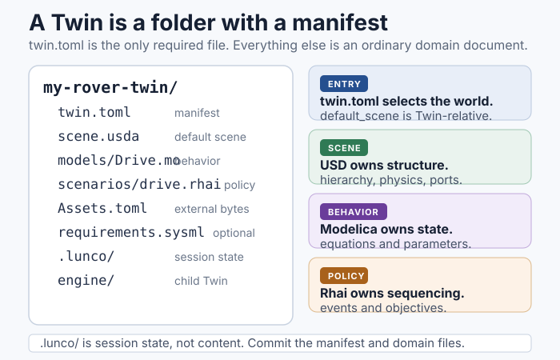

# Twins

A **Twin** is a project folder for one engineered system: a lunar base, a rover
test rig, a lander, a power subsystem, or a whole mission. It is the unit of
saving, versioning, sharing, and opening in LunCoSim.

A folder becomes a Twin when it contains `twin.toml`. That manifest is the only
required file.

<figure>
<a href="../assets/images/twin-layout.svg"></a>
<figcaption>A typical Twin layout. The manifest selects the entry scene and the
source roots; the other files remain ordinary domain files.</figcaption>
</figure>

## A minimal Twin

```text
my-rover-twin/
├── twin.toml
├── scene.usda
├── models/
│   └── Drive.mo
├── scenarios/
│   └── drive.rhai
└── .lunco/              # session state, not project content
```

`twin.toml` declares the project name, version, entry scene, and search roots.
The other files are ordinary domain files:

| File | Role |
|---|---|
| `scene.usda` | The USD scene that becomes the active world |
| `models/Drive.mo` | A Modelica source file |
| `scenarios/drive.rhai` | A Rhai scenario or test policy |
| `.lunco/` | Local session and workspace state; normally gitignored |

## Standard files, tool-specific manifest

A Twin deliberately separates tool configuration from system modeling:

- **USD** owns geometry, composition, materials, physics, and connections.
- **Modelica** owns equations and continuous state.
- **SysML** owns requirements and system structure, when the Twin uses them.
- **Rhai** owns scenario and test policy.
- **TOML** owns tool configuration: `twin.toml` and `Assets.toml`.

The domain files stay in their standard syntax. A `.mo` file is still a normal
Modelica file, a `.usda` file is still normal USD, and a `.sysml` file is still
normal SysML. LunCoSim-specific configuration lives in `twin.toml`, so those
files remain usable in other tools.

## File, folder, or Twin

LunCoSim supports three levels of structure:

| Mode | What you open | What you get |
|---|---|---|
| **File** | One `.usda`, `.mo`, or other document | Edit that file; no project-level discovery |
| **Folder** | A folder without `twin.toml` | Browse and edit files; no manifest, no Twin search roots |
| **Twin** | A folder with `twin.toml` | Full project discovery, default scene, libraries, and Twin settings |

You can promote a folder to a Twin at any time by adding a `twin.toml` or by
using **Save as Twin…**. The files do not move.

## The manifest is read at open

The manifest is not watched for structural changes. If you edit
`default_scene`, the Modelica source roots, or the SysML roots, reopen the Twin
before expecting the change to take effect. The parser rejects unknown fields,
so a typo fails visibly instead of being silently ignored.

The `[settings]` table is different: it is a live, namespaced scalar map that
Rhai and the Twin settings panel can read and write. See
[twin.toml](../reference/twin-toml.md) for the field reference.

## Nested Twins

A Twin can compose child Twins:

```toml
[[children]]
name = "engine"
path = "engine"
```

Opening the parent loads local children eagerly. A child can be a complete
project in its own right, which is useful for an engine, a comm stack, or a
science payload that is also developed separately.

Remote URL children are reserved for future remote-Twin support; they are
listed in the manifest but are not followed today.

## Lifecycle

Opening and closing a Twin is a real lifecycle boundary. When a Twin closes,
its documents, Modelica participants, scripts, timelines, and scene-owned state
are retired before another Twin can use those names. If you switch projects,
expect a fresh load rather than a reuse of the previous session's state.

This is why a Twin is a better unit than a loose collection of tabs: the
project owns its resources and can shut them down as one system.

The boundary also applies to runtime UI. A Twin can provide its own presentation
manifest; closing the Twin restores the shared application surfaces. See
[Runtime UI](../ui/runtime-ui.md).

## Create or open a Twin

- **File → New Twin…** creates a manifest and opens the new project.
- **File → Open Twin…** opens an existing folder with `twin.toml`.
- **Save as Twin…** promotes the current document or scene into a new project
  folder.

Once the Twin is open, the **Twin** panel shows its files. The declared default
scene is loaded into the viewport; other USD files remain a referenceable asset
library until a scene references them.

## What belongs in the project

A Twin should contain the files that define the system and the policy that
travels with it. A useful test is: if a colleague opened this folder on another
machine, would they need this file to reproduce the authored system?

| Belongs in the Twin | Does not belong in the Twin |
|---|---|
| USD scenes, assemblies, and variants | Downloaded cache bytes |
| Modelica sources and package structure | Generated solver artifacts |
| Rhai scenarios, tutorials, and tests | Screenshots and scratch recordings |
| `Assets.toml` declarations | Absolute machine paths |
| `twin.toml` and project settings | User-global preferences |
| SysML requirements and verification mappings | Secrets or private tokens |

External bytes are declared, not copied. Use `Assets.toml` to name the source,
destination, and optional hash. The asset system resolves the logical address
to the local cache.

## Sharing a Twin

A Twin is an ordinary folder. You can version it with Git, zip it, or hand it
to a colleague. Before sharing:

1. Remove local session state and any large generated artifacts.
2. Confirm that every external asset is declared in `Assets.toml`.
3. Confirm that the default scene opens on a clean machine.
4. Run the authored validation and scene test.
5. Record the LunCoSim build and any reference data used for an accuracy claim.

The [Validate and share](../tutorials/validate-and-share.md) tutorial walks
through the complete handoff.

## Related sections

- [twin.toml](../reference/twin-toml.md) — the manifest reference
- [Assets.toml](../reference/assets-toml.md) — external asset declarations
- [Create a Twin](../tutorials/create-a-twin.md) — a hands-on walkthrough
- [How it fits together](how-it-fits-together.md) — the layer boundaries
- [Runtime UI](../ui/runtime-ui.md) — Twin-owned presentation assets
