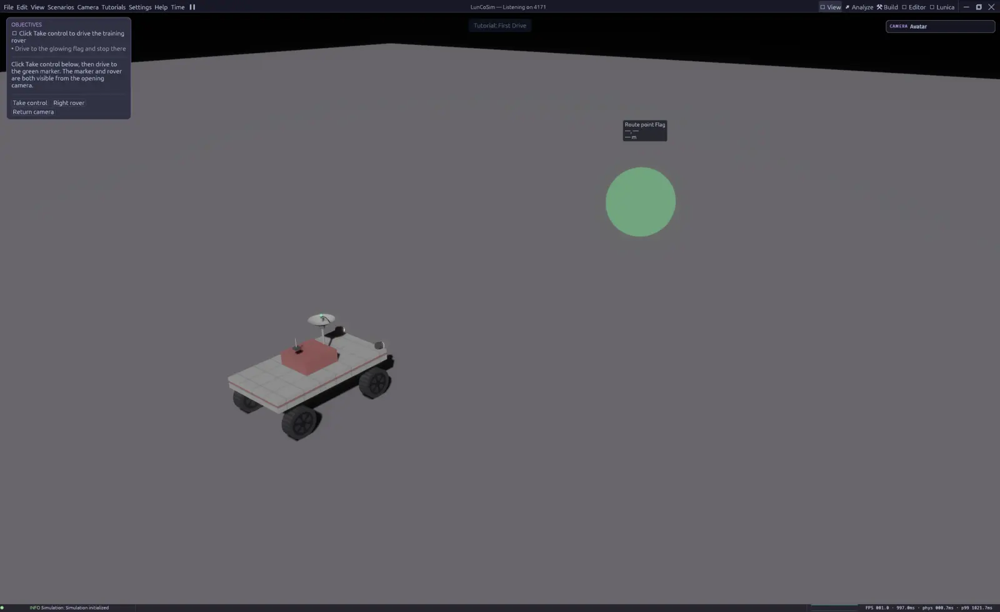

# First lesson

The first lesson is a real simulation, not a slideshow. You take control of a
rover, drive it with physics, and complete objectives that are checked against
the live world.

## Option A — Lunar Rover Lab (30 minutes)

**Tutorials → Start Here → Lunar Rover Lab**

This is the recommended classroom activity. You will:

1. Drive to a marker and stop inside it.
2. Open a speed graph and identify a real motion sample.
3. Predict the result of changing drive demand, then run two trials.
4. Explain the measured result.
5. Move a block into an authoring bay.
6. Save the result as your own Twin.

The lesson card stays visible across perspectives. **Instructor checkpoints**
let you jump to driving, telemetry, or comparison practice without pretending
the earlier tasks were completed. **Restart whole lab (discard edits)** resets
the document through the normal scene restart.

## Option B — First Drive (5 minutes)

**Tutorials → Sandbox → First Drive**

Use this when you only want to see the core loop:

1. Open the lesson.
2. Click **Take control**.
3. Drive to the glowing flag.
4. Stop inside the marker.

The rover's motion comes from the authored Modelica controller and the native
physics engine. The lesson script observes possession, the flag sensor, and the
rover's speed; it does not advance from elapsed time.

<figure class="shot">

<figcaption>The lesson card names the current objective and the actions that are valid now. Progress is checked against the live simulation.</figcaption>
</figure>

## Reading the lesson card

The card shows the current objective and the actions that are valid now. Some
actions are mouse buttons in the card, some are keyboard controls, and some are
buttons that open another perspective.

The lesson uses semantic input hints such as **forward**, **brake**, and
**left**. The displayed key is resolved from your current input bindings, so
re-binding an action changes both the actual control and the lesson text. See
[Controls](../reference/controls.md).

## What just happened

Under the lesson there is a normal Twin:

- A **USD scene** owns the rover, the ground, the flag, the camera, and the
  sensors.
- A **Modelica model** owns the rover's continuous drive behavior.
- A **Rhai scenario** owns the lesson steps, hints, objectives, and completion
  checks.
- The **runtime** projects the scene into physics, steps the model, and
  delivers events back to the scenario.

That division is the main idea behind LunCoSim. Continue with
[How it fits together](../concepts/how-it-fits-together.md).
