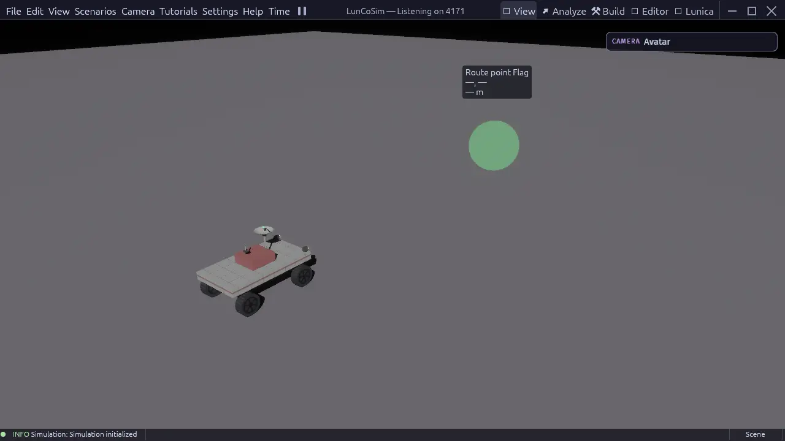

# First run

When LunCoSim opens, you are looking at a workbench, not a single fixed editor.
The same Twin can be viewed as a running mission, a scene assembly, a graph
dashboard, a USD document, or a Modelica model.

## The window

| Area | What it does |
|---|---|
| Title bar | Documentation, Community, Tutorials, and the perspective tabs |
| Viewport | The live 3D scene, selection, camera, and ground interaction |
| Side panels | Twin files, Entity tree, Inspector, Environment, Spawn, Telemetry, Ports |
| Bottom dock | Graphs, timelines, logs, and document tabs |
| Status bar | Update notices, simulation state, and transient messages |

The exact panels depend on the active perspective. **View → Reset Layout**
restores the authored default for the current task.

<figure class="shot">

<figcaption>The View perspective with the First Drive sandbox open. Panels and tabs change when you switch perspectives.</figcaption>
</figure>

## Perspectives

Choose a perspective from the title bar or **View → Perspectives**:

| Perspective | Use it for |
|---|---|
| **View** | Operating the live mission in a full-window scene |
| **Build** | Composing the scene from assemblies, entities, and the Twin's files |
| **Analyze** | Comparing signals in Graphs, with Telemetry and Ports |
| **Editor** | Editing one explicit USD document in an isolated preview |
| **Lunica** | Modelica diagrams, equations, compilation, and experiments |

Switching perspectives preserves the Twin and the simulation. You are changing
the layout and the visible tools, not restarting the world.

## Open the Tutorials menu

The **Tutorials** menu contains the authored lesson catalog. Tracks include
**Start Here**, **LunCoSim**, **Navigation**, **Sandbox**, **Rover Driving**,
and **Modelica**.

Each entry is a tour, an exercise, or a challenge:

- A **tour** explains where things are. It does not certify that you performed
  an action.
- An **exercise** advances only when the simulation observes the requested
  result.
- A **challenge** is a longer open-ended task.

Selecting a lesson loads its authored scene when the lesson needs one, then
starts the lesson's Rhai scenario. This is the easiest way to see a working
Twin without building one first.

## First five minutes

1. Open **Tutorials → Start Here → Lunar Rover Lab** for the full 30-minute
   classroom exercise, or **Tutorials → Sandbox → First Drive** for a
   five-minute rover drive.
2. Wait for the scene and the lesson card to settle. The viewport shows the
   practice yard; the card explains the current step.
3. Click **Take control**. Selection is not control: you must claim the rover
   before your input reaches it.
4. Drive with the displayed bindings. The defaults are
   <kbd>W</kbd>/<kbd>S</kbd> for forward and reverse, <kbd>A</kbd>/<kbd>D</kbd>
   to steer, and <kbd>Space</kbd> to brake. The lesson uses
   `input_hint(...)`, so it always shows the bindings currently configured on
   your machine.
5. Follow the on-screen objective. When you reach the marker, stop inside it.
   The lesson checks the simulation state, not a timer.

If the rover rolls over, use **Right rover**. If you lose the view, use
**Return camera**. Both actions preserve lesson progress.

## If you get stuck

- The vehicle ignores your input: click **Take control** first.
- The viewport is empty: open a scene or lesson; a Twin with no
  `default_scene` opens as a file browser, not a world.
- An asset is missing: LunCoSim asks before downloading declared external
  assets. See [Assets.toml](../concepts/assets-toml.md).
- The app will not start on a port: choose another free `--api` port.

Continue with [First lesson](first-lesson.md) for the suggested learning path,
or read [How it fits together](../concepts/how-it-fits-together.md) to
understand what the lesson is doing behind the scenes.
