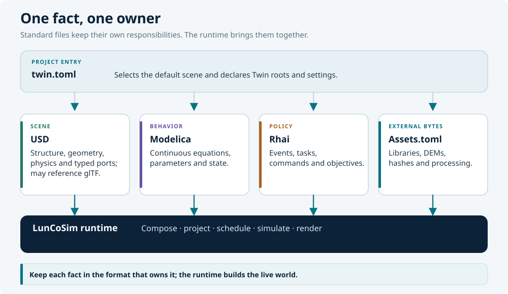

# LunCoSim Documentation

**Build a space mission. See how it behaves.**

LunCoSim is an open-source simulation workbench for space engineers,
researchers, and students. You assemble a vehicle and its environment, connect
physical models, and watch the system behave through a mission.

This site is the user guide. It covers installation, the first lessons, and the
concepts behind a LunCoSim project.

## Start here

- **Install LunCoSim**

    Download the desktop package for Windows, macOS, or Linux, then launch it.

    [Install LunCoSim](getting-started/install.md)

- **Run your first lesson**

    Open the Tutorials menu, take control of a rover, and complete a short
    guided exercise.

    [First lesson](getting-started/first-lesson.md)

- **Learn the project model**

    Understand what a Twin is, how `twin.toml` declares it, and which file owns
    which part of the simulation.

    [How it fits together](concepts/how-it-fits-together.md)

- **Write a scenario**

    Use Rhai to react to events, command a rover, and sequence a mission.

    [Write a Rhai scenario](guides/write-a-scenario.md)

## What you can do

- **Build and drive a rover.** Assemble a vehicle, explore wheel and suspension
  behavior, and observe its interaction with terrain.
- **Connect equations to motion.** Wire a Modelica controller to a rigid body
  and inspect the feedback loop while it runs.
- **Explore subsystem behavior.** Edit electrical, thermal, and mechanical
  models in the embedded Modelica workbench and compare plots.
- **Script an operation.** Define mission phases, waypoints, and responses to
  events, then inspect the resulting state in the UI or over the API.
- **Share a project.** A Twin is an ordinary folder of USD, Modelica, Rhai, and
  configuration files that you can version and hand to a colleague.

## The four formats

| Format | Owns | Typical files |
|---|---|---|
| **USD** | Scene structure, geometry, materials, physics schemas, typed ports and connections | `.usda`, `.usdc` |
| **Modelica** | Continuous equations, state, and physical behavior | `.mo` |
| **Rhai** | Events, commands, mission policy, and test verdicts | `.rhai` |
| **TOML** | The Twin manifest and external asset declarations | `twin.toml`, `Assets.toml` |

The runtime projects those authored documents into a live world. Rust and
Avian provide the generic engine mechanics; they are not where you author a
particular rover, mission, or lesson.

## Documentation map

| Section | What it answers |
|---|---|
| [Getting started](getting-started/install.md) | How do I install and launch LunCoSim? |
| [Concepts](concepts/how-it-fits-together.md) | What is a Twin, and how do USD, Modelica, Rhai, and assets interact? |
| [Guides](guides/create-a-twin.md) | How do I create a project, script behavior, and inspect telemetry? |
| [Reference](reference/cli.md) | What are the CLI flags and default controls? |

## Current status

LunCoSim is under active development. Model coverage and maturity vary, and
engineering conclusions need validation for their intended use. Use the
[GitHub releases](https://github.com/LunCoSim/lunco-sim/releases) page to see
the current builds and release notes.

## Community

- [LunCoSim on GitHub](https://github.com/LunCoSim/lunco-sim)
- [Discord](https://discord.gg/A6U3GdvQum)
- [YouTube demos](https://www.youtube.com/@LunCoSim)
- [lunco.space](https://lunco.space/)
