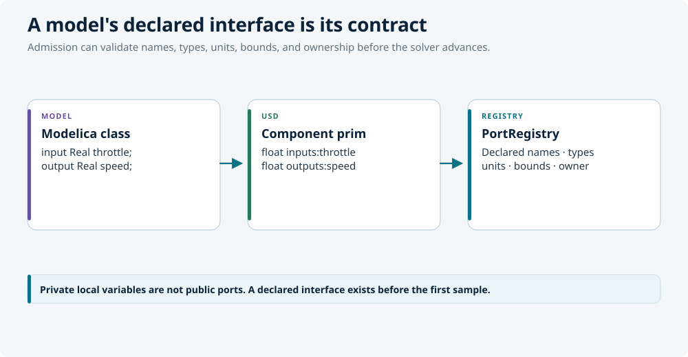
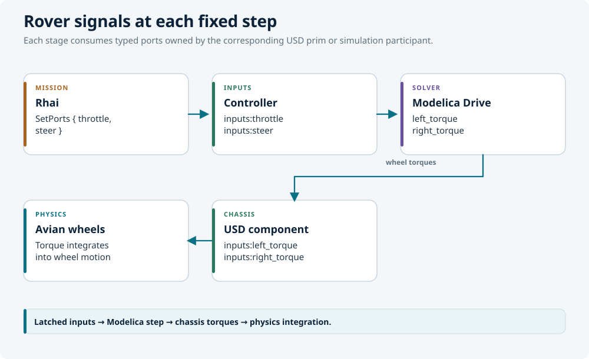

# Cosimulation

Cosimulation is the contract between a Modelica model and the rest of the
world. The model advances in its own solver; physics advances in Avian; the
master clock decides when the two exchange values. Neither side reaches into
the other's state.

LunCoSim implements an **FMI-CS-shaped master algorithm**. It is not a claim
that every participant is an FMI implementation. The native Modelica worker
and the FMI 3 Co-Simulation backend share the same master invariants.

## The master loop

At every fixed step:

1. The master clock reaches a communication point.
2. Each due participant receives an input snapshot.
3. The participant advances by one communication step.
4. The master waits for every due participant to return.
5. Validated outputs are published with zero-order hold.
6. Connections propagate the new values.
7. Physics and rendering observe the result.

The loop is a data-plane system. It runs directly in `FixedUpdate`; it is not
driven through the typed command bus. A command per tick would put a request
id, a dispatch, and a result record in the hot loop for no benefit.

Commands own the control plane: load a scene, compile a model, start or pause a
run, change time warp. They start and configure the loop; they do not advance
it.

## Communication points and hold

A communication point is the only time at which values cross the boundary.
Between points, the last validated outputs are held. This is the zero-order
hold that makes a coupled step deterministic: every consumer sees the same
value for the whole interval, regardless of when it reads.

The default running communication interval is one master physics tick. Longer
integer tick multiples are explicit multirate settings. Each worker request
admits its ordered input vector atomically, and the shared clock waits for the
complete validated response.

A participant that misses its step budget does not silently return a stale
value. The step fails visibly, the coupled step faults, and the simulation
holds.

## Participants and ports

A participant is a `SimComponent` with named inputs and outputs. Its interface
is published from the model's **declaration**, not from its solution:

<figure class="diagram">
  
  <figcaption>The runtime publishes the declared interface before the solver has produced a sample.</figcaption>
</figure>

This ordering matters. A model that has not produced a sample yet still has an
interface. Admission can check the wire, the units, and the initial inputs
before the solver has run.

A model output becomes externally connectable only when the component prim
declares the matching `outputs:<name>` property. The runtime does not expose
private local variables as public ports.

## Initial admission

Initialization is not "step from zero and hope." The owner separates
declaration, numerical admission, and running exchange:

1. Source interfaces and native physical definitions become available.
2. Acyclic participants initialize from finite producer samples.
3. Participants with complete inputs prepare independently.
4. Coupled participants are captured into a composite initialization problem.
5. The composite is compiled and solved at one physical coordinate.
6. Members are released together only after their observations agree within
   solver tolerance.

The `synth.coupled-initialization` hook emits the composite. Rust supplies the
member facts, classes, bindings, and probes; Rhai emits the nested array
literals in their checked order. Participant parameter values travel separately
as qualified `Initialize.parameter_overrides` names such as `p0.k` or
`p0.gains[2]`.

A missing required free coordinate is an error, including an explicitly empty
supplied inventory. Failed certification reports a terminal runtime fault and
holds the affected participants. A changed source or wire cannot release an old
certificate.

This follows FMI 3.0's separation of Initialization Mode and running
communication: initialization loops are solved at one physical coordinate
before participants advance.

## Modelica output ownership

Modelica publishes outputs through its worker response path. The response
bridge validates the session, step identity, and communication endpoint before
taking the in-flight transaction. Session IDs fence stale results: when a
compile or parameter update bumps the session, an in-flight step for the old
session is discarded.

The worker reuses immutable compiled DAE artifacts for the same exact target,
document URI, assembled source bytes, and source-root revision. Parameter
bindings, solver instances, live state, and telemetry remain per entity.

A live solver step failure keeps the solver error and lists the Modelica values
that were not produced by the failed step. The list includes each value's last
accepted sample and the sample and communication-target times. Names are sorted
for stable diagnostics.

## Backend registry

Backends self-register at application boot. Each domain crate installs a Bevy
plugin that inserts itself into `BackendRegistry`. Dropping a crate removes its
backend. A scenario that references a missing backend fails gracefully at load.

Current backends include:

| Backend | Source | Notes |
|---|---|---|
| Modelica | `.mo` | Rumoca worker |
| Rhai | `.rhai` | Scripted participant |
| Python | `.py` | Optional feature |
| FMI 3 CS | `.fmu` | Native import, scalar Float64 profile |
| Avian | USD physics | Typed-port participant |

The FMI adapter uses the existing port and connection boundary. It loads and
validates `modelDescription.xml`, preserves value references and scalar
engineering contracts, and runs the FMI 3 Co-Simulation lifecycle on its native
worker.

## The FMI boundary

The native profile supports scalar `Float64` ports. Unit and range projection
are implemented, and the shared connection fabric compiles compatible unit
conversions. The importer declines Event Mode and early return; FMUs handle
their internal events. `lastSuccessfulTime` must match the requested
communication point within the timestamp tolerance.

FMI permits `lastSuccessfulTime` to deviate from the requested endpoint even
when `earlyReturn` is false. The owner faults such a response because the
current master cannot synchronize all participants at the reported time.
Supporting intermediate communication points would require rescheduling the
complete due participant set.

FMI Model Exchange requires a separate solver integration and is not admitted
as an FMI-CS participant. Other types, arrays, Scheduled Execution clocks, and
externally hosted FMUs are rejected with owner diagnostics.

This is an FMI-CS-shaped master, not a broad conformance claim. FMU-to-FMU unit
conversion, implicit coupling, and full FMI conformance require separate
qualification.

## Pause, time warp, and health

Pausing stops the master clock without tearing down participants. A paused
model retains its state and its last outputs. Resuming continues from the same
communication point.

Time warp changes how fast wall-clock time advances relative to simulation
time. It does not change the communication contract: the master still waits for
every due participant at each point.

Modelica execution publishes a scene-scoped `ModelicaHealthSnapshot` from the
admitted step counters. Its one-second native wall-clock window reports
completed-step FPS and worker service time through the shared `engine-health`
exposure. This diagnostic math does not change simulation scheduling.

## Worked example

A rover has a Modelica drivetrain, an Avian chassis, and a Rhai mission:

<figure class="diagram">
  
  <figcaption>The mission input is latched before the fixed step; Modelica torque outputs enter the chassis before Avian integrates motion.</figcaption>
</figure>

At each fixed step:

1. The mission's latest command is already latched in the port registry.
2. The controller receives `throttle` and `steer`.
3. The solver advances and returns the two torques.
4. The torques propagate to the chassis inputs.
5. Avian applies them to the wheels.
6. The next step samples the new chassis state.

The mission does not step the controller. The controller does not read the
scene. The chassis does not know which language produced the torque.

## Rules of thumb

- Treat the fixed step as the only exchange point.
- Declare the interface before relying on a sample.
- Expect a missing initial input to hold admission, not to become zero.
- Keep continuous behavior in Modelica; keep discrete decisions in Rhai.
- Use multirate only when a participant genuinely needs a slower clock.
- Inspect `CausalTrace` when a value does not arrive where the wire says it
  should.
- Do not claim FMI conformance beyond the tested scalar profile.

Continue with [Lunica](lunica.md), the workbench for authoring and running these
models.
