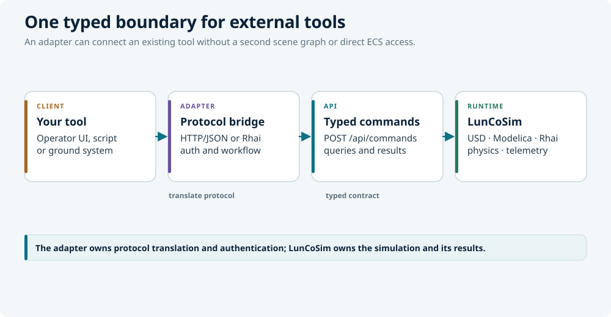

# Mission control

LunCoSim is a simulation workbench, not a mission-control system. It exposes a
typed command and query API that a ground-segment or operator adapter can drive.
No YAMCS, Open MCT, or Grafana adapter is bundled in this build.

The integration shape is simple:

<figure class="diagram">
  
  <figcaption>LunCoSim offers a typed API; an external adapter supplies protocol translation and operator workflow.</figcaption>
</figure>

The adapter owns protocol translation, authentication policy, and operator
workflow. LunCoSim owns the scene, simulation state, authority, and typed
results.

## What is available

| Need | Surface |
|---|---|
| Discover entities and ports | `ListEntities`, `ListPorts` |
| Claim an endpoint | `ClaimControl` |
| Write live inputs | `SetPorts`, `SetPortsBatch` |
| Release an input or claim | `ReleasePort`, `ReleaseControl`, `ReleaseControlClaim` |
| Read current values | `ReadPorts`, `ReadPortsBatch`, `ReadActuatorStatus` |
| Read telemetry | `ListTelemetryChannels`, `QueryTelemetryHistory`, `ExportTelemetryRecording` |
| Check health | `GET /api/ready`, `GET /api/diagnostics` |
| Inspect coupling | `CosimStatus`, `GetBrokenConnections`, `CausalTrace` |
| Capture admitted inputs | `StartSessionInputCapture`, `StopSessionInputCapture`, `ExportSessionInputCapture` |

Not shipped:

- YAMCS, Open MCT, or Grafana adapters.
- CCSDS or XTCE translation.
- A ROS 2 bridge ([issue #57](https://github.com/LunCoSim/lunco-sim/issues/57)).
- Whole-session deterministic replay.

Use the absence of an adapter as an adapter task, not as a missing runtime
control surface.

## Start with readiness

Launch with an explicit, free API port and keep the API on loopback:

```bash
luncosim --api 4101
```

Do not expose the command endpoint to an untrusted network. It executes powerful
authoring and control commands and has no general-purpose remote authentication
layer.

Wait until the scene is admitted:

```bash
curl -s "http://127.0.0.1:4101/api/ready"
```

Proceed only when `ready` is true, `world_hold` is false, and `pending_count` is
zero. A faulted world is not a slow world; read `/api/diagnostics` and the
readiness detail instead of retrying commands.

## A minimal operator adapter

The following Python example shows the lifecycle. It assumes the endpoint is a
rover and that its declared input names are `throttle`, `steer`, and `brake`.

```python
import json
import time
import urllib.request

PORT = 4101
BASE = f"http://127.0.0.1:{PORT}"
PRODUCER = 4812  # stable for this adapter session; nonzero


def post(command, params=None):
    body = json.dumps({
        "type": "ExecuteCommand",
        "command": command,
        "params": params or {},
    }).encode()
    request = urllib.request.Request(
        f"{BASE}/api/commands",
        data=body,
        headers={"Content-Type": "application/json"},
    )
    with urllib.request.urlopen(request, timeout=10) as response:
        payload = json.load(response)
    if "error" in payload:
        raise RuntimeError(payload["error"])
    return payload["data"]


def find_endpoint(name):
    for entity in post("ListEntities")["entities"]:
        if entity["name"] == name:
            return entity["api_id"]
    raise LookupError(f"no entity named {name}")


endpoint = find_endpoint("Rover")
post("ClaimControl", {"target": endpoint})

try:
    for _ in range(100):
        post("SetPorts", {
            "target": endpoint,
            "writes": [["throttle", 0.2], ["steer", 0.0], ["brake", 0.0]],
            "seq": 0,
            "tick": 0,
            "producer_id": PRODUCER,
        })
        time.sleep(0.05)
finally:
    # Release the hold, then relinquish the endpoint.
    post("ReleaseControl", {
        "target": endpoint,
        "seq": 0,
        "tick": 0,
        "producer_id": PRODUCER,
    })
    post("ReleaseControlClaim", {"target": endpoint})
```

Replace the input names with the names returned by `ListPorts`. A write to a
port that the endpoint does not declare is rejected; it is not silently mapped
to a default.

### Authority rules

- `ClaimControl` claims a stable endpoint for the originating session.
  `AcquireControl` is the UI-oriented variant that also binds the local camera.
- Use `ReleaseControlClaim` on disconnect. Do not rely on timeout cleanup.
- `SetPorts` is a live input hold. `ReleaseControl` and `ReleasePort` return the
  input to its authored wiring; they do not write a stop value. If the safe
  state requires a specific setpoint, write it explicitly before releasing.
- Keep one stable, nonzero `producer_id` per operator or adapter session. The ID
  records provenance; it is not an authorization credential.
- A claim is exclusive per endpoint. A successful `ClaimControl` releases the
  previous owner's claim when RBAC and claim policy allow the takeover; do not
  write through another session's claim without claiming first.
- `SetPortsBatch` is atomic on an authoritative host or local embodiment.
  Shared clients and authenticated network sessions should use single-target
  `SetPorts`, `ReleasePort`, and `ReleaseControl`.
- A rejected command is terminal. Read the error and fix the target, port, or
  value; do not retry the same request blindly.

## Read telemetry

Discover the retained channels first:

```python
channels = post("ListTelemetryChannels")["channels"]
key = channels[0]["key"]

history = post("QueryTelemetryHistory", {
    "key": key,
    "limit": 200,
})
```

Each sample has a simulation time `t` and a value `v`; the response also carries
`epoch_jd` when a mission epoch is available. A missing value is a hole, not a
zero.

For a recording that can be compared with an experiment or external tool:

```python
recording = post("ExportTelemetryRecording", {
    "keys": [key],
})
```

The recording has a union time grid and `null` for channels that did not report
at a given time. It deliberately does not interpolate.

For the current wiring boundary, use `ListPorts` and then `ReadPorts` or
`ReadPortsBatch`. `ReadPortsBatch` returns one shared `sim_tick`, so values from
different endpoints can be compared at the same simulation moment. Use
`ReadActuatorStatus` when the question is whether a commanded actuator has
settled within a tolerance.

## Audit and replay

`StartSessionInputCapture` records a bounded slice of admitted session inputs.
`StopSessionInputCapture` refuses while an admitted input is still waiting for
its fixed-tick commit. On a native host, `ExportSessionInputCapture` writes a
durable `.lcsin` archive; `ReadSessionInputArchiveExport` reports its status.

That archive is an input record, not a complete replay package. It does not
contain a baseline manifest or a playback consumer, and not every command is in
the input slice. `CausalTrace` ties an admitted input to its producer, tick, and
sequence, which is useful evidence for an operator action.

Do not claim bit-reproducible mission replay from this build. Deterministic
replay is a separate engineering track.

## ROS 2 and other protocols

There is no shipped ROS 2 bridge. Keep ROS 2 outside the simulator and translate
its command and telemetry topics into `ClaimControl`, `SetPorts`, and the
telemetry queries above. The same pattern applies to YAMCS, Open MCT, Grafana,
or a custom ground tool.

The adapter should:

1. Wait for readiness.
2. Discover the exact entity and port names.
3. Claim the endpoint before writing.
4. Send finite values at a controlled cadence.
5. Read telemetry or ports for feedback.
6. Release the hold and claim on shutdown.
7. Expose a clear failure when the API rejects an input.

## Checklist

- [ ] The API is bound to a loopback or otherwise private interface.
- [ ] The scene is ready before the first write.
- [ ] The adapter uses stable entity identities, not display names.
- [ ] The adapter knows the declared port names and directions.
- [ ] One operator owns the endpoint claim.
- [ ] The safe condition is written before releasing an input, when required.
- [ ] The adapter releases its claim on every exit path.
- [ ] Rejections are visible to the operator, not retried silently.
- [ ] Telemetry uses a single tick for comparisons.
- [ ] The test includes a negative case and a real verdict.

## Related

- [Use the HTTP API](http-api.md) — request envelope and schema discovery
- [Telemetry](../ui/telemetry.md) — live values, history, and graphs
- [Integrate your stack](../general/integrate-your-stack.md) — supported boundaries and
  limitations
- [Validation](validation.md) — evidence and accuracy claims
