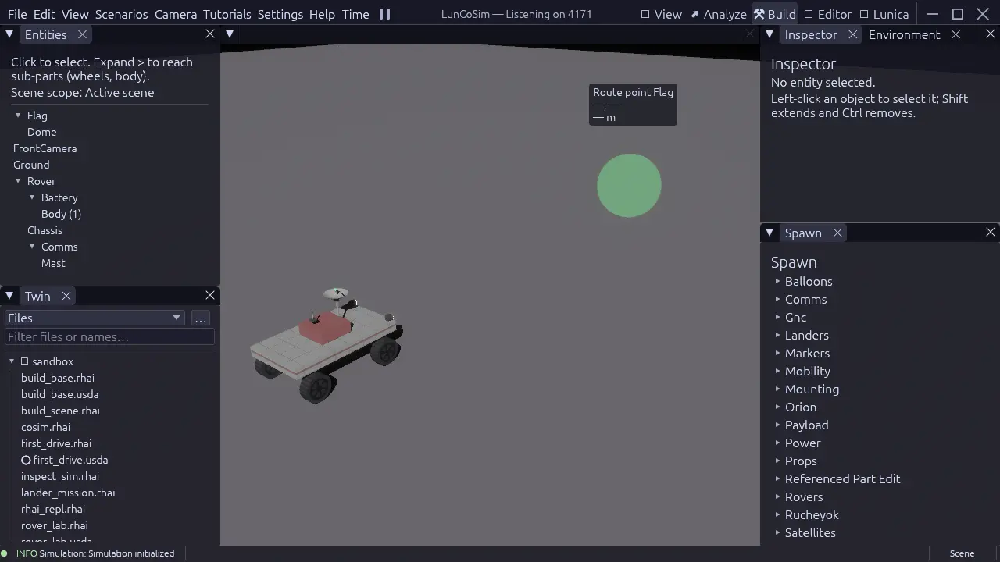

# Build a scene

A scene is the USD stage that becomes the live world. **Build** is the
perspective for composing it: placing assemblies, adjusting transforms,
inspecting prims, and saving the result into the authored stage. The
simulation keeps running while you work, so a change can be observed
immediately.

This tutorial assumes that you have a Twin with a default scene. If you do not,
complete [Create a Twin](create-a-twin.md) first.

## Open the scene in Build

1. Open the Twin. Its `default_scene` is mounted into the viewport.
2. Switch to **Build** from the title bar or **View → Perspectives**.
3. Confirm that the **Entities** tree and the **Twin** file browser are visible
   on the left, and **Inspector**, **Environment**, and **Spawn** are on the
   right.

The **Entities** tree shows the live runtime objects. The **Twin** browser shows
the authored files. They are related but not identical: an entity can be
generated at runtime, and a file can exist in the Twin without being part of
the active scene.

## Place an assembly

1. Open the **Spawn** palette.
2. Choose an assembly category, such as a rover, a habitat, or a ground prop.
3. Click a placement point in the viewport, or drag the assembly into the
   scene.
4. The new object appears in **Entities** and in the viewport.

A spawned assembly is a reference into the scene, not a copy of the source
file. The scene stores the placement and any overrides; the reusable asset
stays in the installed library or the Twin.

<figure class="shot">
<a href="../../assets/images/screenshots/perspective-build.webp"></a>
<figcaption>Build places the scene tree, the Twin's files, the Inspector, and the
Spawn palette around the live scene.</figcaption>
</figure>

## Adjust the transform

Select the object in **Entities** or click it in the viewport. The
**Inspector** shows the selected prim's properties. Use the transform gizmo or
the Inspector fields to set position, rotation, and scale.

The scene placement owns the initial heading. The reusable asset owns its local
geometry and its canonical frame. Do not duplicate a heading in the asset, a
variant, and a wrapper layer; keep one authoritative placement and let the
vehicle controller own later changes.

A prim that can be rotated must declare the rotation op in `xformOpOrder`. An
attribute that is not listed in the order is inert, even if it has a value:

```usda
double3 xformOp:translate = (4, 0, 8)
float3 xformOp:rotateXYZ = (0, 35, 0)
uniform token[] xformOpOrder = ["xformOp:translate", "xformOp:rotateXYZ"]
```

## Inspect the prim

The Inspector is a view over the authored prim, not a separate settings store.
Editing a value authors a typed USD operation through the document owner. The
change appears in the **Change History** journal when the document is open in
**Editor**.

Useful checks before saving:

| Check | Why |
|---|---|
| The prim has the expected schema, such as `UsdPhysics.RigidBodyAPI` | A body without the schema will not move |
| A movable child has a joint | A nested body without a joint is reported by the scene linter |
| Mass and collision geometry are present | A collider without mass or a body without a collider behaves unexpectedly |
| The transform op is listed in `xformOpOrder` | An unlisted op is ignored |
| The asset reference resolves | A missing reference composes as an empty prim |

## Scene-wide environment

**Environment** owns scene-wide settings such as lighting and the environment
profile. Use it when the question is about the whole scene rather than one
prim: the sun, the sky, the ambient conditions, or the terrain context.

Do not put a per-object light or a per-object material override in the
environment panel. Those are prim properties and belong on the object.

## Save the scene

Use **File → Save** or <kbd>Ctrl</kbd>+<kbd>S</kbd> to save the active scene
document. The save writes the authored USD stage through the document journal;
it does not rewrite unrelated files.

If the scene was opened as a lesson or an installed example, **Save as Twin…**
creates a project copy before you edit it. Saving into the installed library is
not the intended workflow.

## Compose, do not duplicate

A scene can reference a reusable rover and place two instances with different
transforms:

```usda
#usda 1.0
(
    defaultPrim = "PracticeYard"
    upAxis = "Y"
    metersPerUnit = 1
)

def Xform "PracticeYard"
{
    def Xform "RoverA" (
        prepend references = @lunco://vessels/rovers/skid_rover.usda@
    )
    {
        double3 xformOp:translate = (0, 0, 0)
        uniform token[] xformOpOrder = ["xformOp:translate"]
    }

    def Xform "RoverB" (
        prepend references = @lunco://vessels/rovers/skid_rover.usda@
    )
    {
        double3 xformOp:translate = (8, 0, 4)
        uniform token[] xformOpOrder = ["xformOp:translate"]
    }
}
```

The two rovers share the same source asset. A change to the asset appears in
both placements unless the scene overrides the changed property. This is the
intended way to keep a scene maintainable.

## Common mistakes

| Symptom | Cause | Fix |
|---|---|---|
| The object is visible but does not move | No rigid body or no collider | Add the physics schemas and a collider |
| A mounted part falls away on the first step | Nested body without a joint | Add the joint or remove the nested body |
| The object is in the wrong place | Transform op not listed in `xformOpOrder` | Add the op to the order |
| The scene opens empty | `default_scene` is missing or wrong | Fix the manifest and reopen the Twin |
| The change disappeared | The scene was not saved | Save the document; check Change History |
| A referenced asset is missing | The asset address does not resolve | Check `lunco://` or `twin://` and the asset cache |

## Next steps

Continue with [Add a Modelica model](add-modelica.md) to give the scene
continuous behavior, or [Script a mission](script-a-mission.md) to add a
discrete policy. For the full USD contract, read [USD](../usd/index.md).
