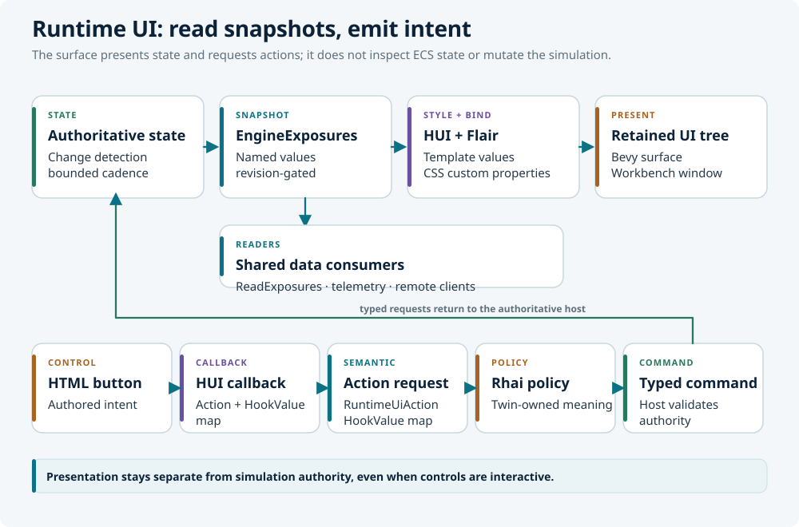

# Compose a HUD

LunCoSim has a small runtime-authored presentation layer for HUDs, telemetry
cards, progress overlays, and other Twin-facing surfaces. It looks like HTML
and CSS, but it is not a browser: templates become retained Bevy UI entities,
and styles become Bevy components through HUI and Flair.

This tutorial adds a mission-status card to a Twin. The card reads a typed
exposure, displays two values, and emits a semantic action when a button is
pressed.

## Understand the boundary

A runtime surface may read a named engine capability and emit a semantic
action. It cannot inspect ECS state or directly mutate the simulation.

<figure class="diagram">
  
  <figcaption>Exposure snapshots feed presentation and external readers. Authored buttons emit semantic actions that the host validates.</figcaption>
</figure>

The template owns structure and declared properties. The stylesheet owns
appearance and internal layout. The manifest owns the outer rectangle,
bindings, actions, gates, and placement. Rhai owns the meaning of an authored
action.

## Create the Twin manifest

A Twin can provide its own JSON manifest with
`kind: "lunco.runtime-ui-manifest.v1"`. Normal Twin loading composes it over the
application surfaces by stable ID; closing the Twin restores the shared
surfaces.

Create a file under the Twin:

```text
my-rover-twin/
└── ui/
    ├── mission.json
    ├── status.html
    └── status.css
```

A minimal manifest looks like this:

```json
{
  "kind": "lunco.runtime-ui-manifest.v1",
  "surfaces": [
    {
      "id": "mission-status",
      "template": "ui/status.html",
      "stylesheet": "ui/status.css",
      "namespace": "mission-status",
      "bindings": {
        "title": { "source": "title" },
        "state": { "source": "state" }
      },
      "actions": [
        {
          "callback": "runtime_status_pause",
          "action": "mission.pause"
        }
      ],
      "interactive": true,
      "placement": {
        "mode": "window",
        "anchor": "top_right",
        "offset": [-16.0, 16.0],
        "width": 260.0,
        "height": 96.0
      }
    }
  ]
}
```

Paths in the manifest resolve from the Twin root. A Twin stylesheet can import
shared fonts with an explicit logical URI:

```css
@import "lunco://ui/runtime_fonts.css";
```

## Write the template

The stable runtime contract uses a deliberately small HUI vocabulary:

```html
<template>
  <property name="title">Mission status</property>
  <property name="state">offline</property>

  <node id="status-root">
    <text id="status-title">{title}</text>
    <text id="status-state">{state}</text>
    <button id="status-pause" on_press="runtime_status_pause">
      <text>Pause</text>
    </button>
  </node>
</template>
```

Rules that matter:

- Use `<template>`, `<property>`, `<node>`, `<text>`, and `<button>`.
- Every template, including a keyed collection row, must have one `<node>` root.
- Put buttons and text elements beneath that root.
- A button's visible caption must be a nested `<text>` node.
- Use stable `id` values and `#id` selectors in the stylesheet.
- HUI does not turn an HTML `class` attribute into a `ClassList`; use `id`
  selectors.

A surface callback receives only the pressed entity. The manifest turns it into
a `RuntimeUiAction`; built-ins remain in the host, while a Twin-authored action
is forwarded as a typed `runtime.ui.action` event for Rhai policy.

## Style the contents

Flair is CSS-like and maps properties to Bevy UI components. The practical
subset includes flex layout, limited grid layout, absolute positioning,
dimensions, spacing, borders, backgrounds, colours, text properties, `#id`
selectors, custom properties, `var(...)`, transitions, and keyframe animations.

```css
@import "lunco://ui/runtime_fonts.css";

#status-root {
  display: flex;
  flex-direction: column;
  gap: 6px;
  padding: 12px;
  background-color: rgba(8, 20, 32, 0.86);
  border: 1px solid rgba(255, 255, 255, 0.18);
  border-radius: 4px;
}

#status-title {
  color: #e8f4f8;
  font-size: 14px;
  font-weight: 700;
}

#status-state {
  color: var(--ui-state-color, #9fd8e4);
  font-size: 12px;
}

#status-pause {
  padding: 4px 8px;
  background-color: #12384d;
  color: #ffffff;
}
```

The manifest owns the outer rectangle; CSS owns the contents. Authored
profiles must fit their contents within the registered size. The runtime pins
the root's minimum and maximum size to the resolved rectangle and clips child
overflow at that boundary.

## Publish the values

An engine producer publishes a typed, named snapshot. A Twin's Rhai policy can
publish UI-owned values through the generic exposure bridge, or an engine
capability can publish them directly. The template never reads ECS state.

A binding with `css: true` also projects a CSS custom property named
`--ui-<property-name>`; ordinary prose never enters the CSS token stream.

```json
"bindings": {
  "title": { "source": "title" },
  "state": { "source": "state", "css": true }
}
```

The producer may map exact rendered values such as `true`, `false`, or `301`
into presentation values. The registry stores typed text, boolean, `f64`,
array, and map values, not CSS or HUI types.

## Handle the action

A Twin-authored action is delivered to Rhai as a typed event. The policy reads
the action and issues a typed command:

```rhai
fn on_event(me, evt, ctx) {
    if evt.name != "runtime.ui.action" { return; }
    if evt.value.action == "mission.pause" {
        pause();
    }
}
```

The exact event shape and command name come from the running application. Use
`GET /api/commands/schema` or the app's command reference when you need an
exact name.

## Gate and place the surface

A surface can declare a perspective filter, a named host gate, and a Twin
setting:

```json
"visible_in_perspective": "sandbox_view",
"setting": "ui.mission_status",
"setting_default": true
```

The setting is a namespaced boolean in the active Twin's `[settings]` table.
Omitted keys use the surface's declared default. The setting is project policy,
not a user-global preference.

Placement modes:

| Mode | Use |
|---|---|
| `viewport` | Full-window overlay, useful for HUDs that frame the 3D scene |
| `dock_panel` | Surface aligned to a workbench panel, with an optional inset |
| `window` | Fixed logical-point rectangle anchored at a corner or center |

A `window` surface may declare `"draggable": true`. Only a descendant tagged
`tag:ui_drag_handle="true"` can move or reset it, so dragging a button does not
move the whole panel.

## Reload and test

On native desktop, the asset watcher reloads runtime UI assets without
relaunching:

| Edit | Result |
|---|---|
| `*.html` | Rebuilds the affected retained surface tree |
| `*.css` or an imported stylesheet | Reapplies Flair styles |
| `runtime_surfaces.json` or the Twin manifest | Replaces registered roots and action mappings |
| `runtime_fonts.css` | Reapplies the font stylesheet |

Changing a Rust producer or action observer requires a rebuilt binary.

To inspect a running surface over the API:

```bash
curl -s -X POST http://127.0.0.1:4101/api/commands \
  -H 'content-type: application/json' \
  -d '{"type":"ExecuteCommand","command":"ReadExposures",
       "params":{"surface":"mission-status"}}'
```

The response contains `revision` and each surface's `state` (`pending`,
`ready`, or `failed`), `error`, `visible`, and typed properties. Wait for
`ready` before reading prepared properties; inspect `failed` rather than
repeating an invalid policy.

## Common problems

| Symptom | Cause | Fix |
|---|---|---|
| Surface absent | Wrong namespace, `visible` false, or a closed gate | Check the manifest, exposure, perspective, and placement |
| Blank value | Target property is not declared or the source name differs | Declare the property and match the binding exactly |
| Button does nothing | Callback spelling differs or no action mapping | Check the template, manifest, and Rhai handler |
| Tofu glyphs | The bundled font is not imported | Add `@import "lunco://ui/runtime_fonts.css";` |
| Style reverts | Rust writes the same style components | Let Flair own presentation |
| Surface jumps on resize | Placement is being corrected per frame | Keep placement in the manifest; use the change-detected boundary |

## Limitations

This is a minimum native UI language, not full CSS. There is no browser DOM,
JavaScript, networking, or browser layout engine. There is one stylesheet per
styled subtree; use `@import` for shared rules. There is no global stylesheet,
and `!important` is detected but ignored. Custom-property fallback values are
not supported. `calc()` is limited by Bevy's `Val` types. Font support is one
explicit `@font-face`, with no browser-like local or fallback chain. Unsupported
web units such as `em` and features such as `text-decoration` are not available.

Use the workbench for editors, docking, rich text, large inspectors, and
controls that need semantics outside this contract. Use runtime HTML/CSS for
Twin-facing presentation that should change without recompiling Rust.

## Related sections

- [Runtime UI](../ui/runtime-ui.md) — the full contract
- [HUD](../ui/hud.md) — shipped surfaces and settings
- [Theming](../ui/theming.md) — colours, fonts, and workbench themes
- [Settings](../ui/settings.md) — global and project settings
