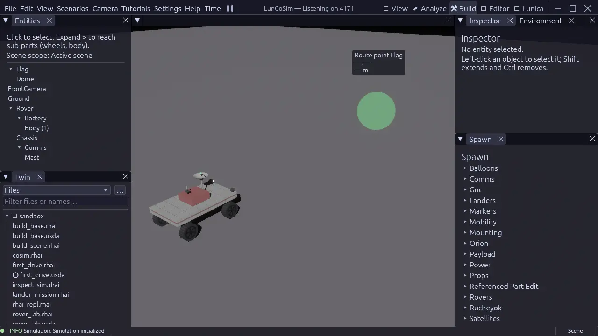

# Create a Twin

There are two practical ways to start a project:

- **Promote a working scene.** Open a lesson or example, then save it as a new
  Twin. This is the fastest way to get a real scene with physics, models, and
  scripts.
- **Start empty.** Create a new Twin and add your own scene and sources.

Both produce the same artifact: a folder with `twin.toml`. The difference is
how much authored content is already present.

## Promote a scene into a Twin

1. Launch LunCoSim.
2. Open **Scenarios → Tutorials → Sandbox → First Drive** so a working scene is mounted.
3. Choose **File → Save as Twin…**.
4. Select or create an empty folder for the project.
5. Confirm. LunCoSim writes `twin.toml` and opens the new Twin.

The new folder contains the scene document and the manifest. The scene keeps
its normal `lunco://` references to the installed library; it is a project that
uses the shared asset bundle, not a self-contained copy of every referenced
asset.

<figure class="shot">
<a href="../assets/images/screenshots/perspective-build.webp"></a>
<figcaption>The Build perspective keeps the scene tree, the Twin's files, the
Inspector, and the Spawn palette together while the simulation keeps
running.</figcaption>
</figure>

## Start from a new Twin

Choose **File → New Twin…**, select a folder, and provide a name. LunCoSim
creates the manifest and opens the project. You can add a scene later.

A minimal manifest looks like this:

```toml
name = "my-rover-twin"
version = "0.1.0"
description = "My first LunCoSim project"

[usd]
default_scene = "scene.usda"
```

The folder should look like:

```text
my-rover-twin/
├── twin.toml
├── scene.usda
├── models/
│   └── Drive.mo
├── scenarios/
│   └── drive.rhai
└── .lunco/
```

`default_scene` is the important line. It tells LunCoSim which USD stage becomes
the active world when the Twin opens. Without it, the Twin opens as a file
browser and does not mount a scene.

## Add a scene

If the Twin was created empty, add a USD file and point `default_scene` at it.
The smallest useful stage declares a default prim and the stage's units:

```usda
#usda 1.0
(
    defaultPrim = "MyTwin"
    upAxis = "Y"
    metersPerUnit = 1
)

def Xform "MyTwin"
{
    def Xform "Ground"
    {
        def Cube "Pad"
        {
            double size = 10
            double3 xformOp:translate = (0, -0.05, 0)
            uniform token[] xformOpOrder = ["xformOp:translate"]
        }
    }
}
```

This stage is inert until the runtime projects it. It has no physics, no
behavior, and no mission. That is enough for a first open; add behavior in the
next tutorials.

## Add behavior

- **Modelica** goes in `.mo` files under the Twin, then a USD
  `LunCoProgramAPI` prim points at it with `info:sourceAsset`.
- **Rhai** goes in `.rhai` files under the Twin, then a `LunCoProgramAPI` prim
  points at the scenario.
- **External assets** go in `Assets.toml`, never as hardcoded cache paths.

The next tutorials build each layer:

- [Build a scene](build-a-scene.md) — place and save assemblies.
- [Add a Modelica model](add-modelica.md) — attach and wire continuous
  behavior.
- [Script a mission](script-a-mission.md) — attach a Rhai scenario.

## Run it

Open the Twin and choose its default scene, or load the scene directly:

```bash
luncosim --api 4101 --scene /path/to/my-rover-twin/scene.usda
```

Use an explicit free API port. Run from the folder containing the Twin if you
are using a source build and relative asset paths.

The application does not guess a starting scene from a folder of `.usda`
files. If `default_scene` is absent or wrong, the Twin opens as a file browser.
That behavior is intentional: a project can contain many scenes and only one
entry point.

## Check the manifest

If the Twin does not open the scene you expect:

1. Confirm `default_scene` is a path relative to the Twin root.
2. Confirm the file exists and is a valid `.usda`.
3. Reopen the Twin after editing the manifest; the manifest is read at open.
4. Check that unknown fields are not present — the manifest parser rejects
   typos.

See [twin.toml](../reference/twin-toml.md) for the field reference.

## Version the project

A Twin is an ordinary folder. Initialize a Git repository at the Twin root and
commit the authored files, not the local session state:

```gitignore
.lunco/
target/
*.tmp
```

Do not commit downloaded cache bytes. Declare them in `Assets.toml` and let the
asset system fetch them. A colleague who clones the Twin should be able to open
it, accept the declared downloads, and run the same authored scene.

## Related sections

- [Twins](../general/twins.md) — the project model and lifecycle
- [twin.toml](../reference/twin-toml.md) — the manifest reference
- [Assets.toml](../reference/assets-toml.md) — external assets
- [Build a scene](build-a-scene.md) — the next authoring step
- [Validate and share](validate-and-share.md) — the handoff
