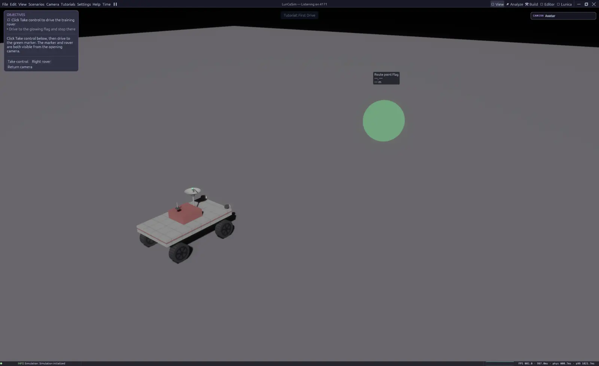

# First mission

The first lesson is a real simulation, not a slideshow. You take control of a
rover, drive it with physics, and complete objectives that are checked against
the live world. The lesson is the fastest way to see the division between USD,
Modelica, Rhai, and the runtime without authoring a project first.

## Before you begin

Launch LunCoSim and wait for the workbench to finish opening. You do not need
to create a Twin or open a scene manually; the lesson launcher selects the
authored scene and starts the lesson's Rhai scenario.

Open **Scenarios → Tutorials** in the menu bar. The catalog opens with the
**Start Here** track expanded.

## Option A — Lunar Rover Lab (30 minutes)

**Scenarios → Tutorials → Start Here → Lunar Rover Lab**

This is the recommended classroom activity. It is an exercise, so each step
advances only when the simulation observes the requested result. You will:

1. Drive to a marker and stop inside it.
2. Open a speed graph and identify a real motion sample.
3. Predict the result of changing drive demand, then run two trials.
4. Explain the measured result.
5. Move a block into an authoring bay.
6. Save the result as your own Twin.

The lesson card stays visible across perspectives. **Instructor checkpoints**
let you jump to driving, telemetry, or comparison practice without pretending
the earlier tasks were completed. **Restart whole lab (discard edits)** resets
the document through the normal scene restart.

## Option B — First Drive (5 minutes)

**Scenarios → Tutorials → Sandbox → First Drive**

Use this when you only want to see the core loop:

1. Open the lesson.
2. Click **Take control**.
3. Drive to the glowing flag.
4. Stop inside the marker.

The rover's motion comes from the authored Modelica controller and the native
physics engine. The lesson script observes possession, the flag sensor, and the
rover's speed; it does not advance from elapsed time.

<figure class="shot">

<figcaption>The lesson card names the current objective and the actions that are
valid now. Progress is checked against the live simulation.</figcaption>
</figure>

## Reading the lesson card

The card shows the current objective and the actions that are valid now. Some
actions are mouse buttons in the card, some are keyboard controls, and some are
buttons that open another perspective.

The lesson uses semantic input hints such as **forward**, **brake**, and
**left**. The displayed key is resolved from your current input bindings, so
re-binding an action changes both the actual control and the lesson text. See
[Controls](../reference/controls.md).

A tour and an exercise look similar but behave differently. A tour advances
when you choose Next; an exercise waits for the world. If an exercise card does
not advance, the current objective has not been observed yet. Read the
objective and the hint before assuming the application is stuck.

## Driving the rover

Selection is not control. Clicking the rover selects it; it does not send your
input to it. Use **Take control** in the lesson card, or click the input
endpoint, before driving.

The default bindings are:

| Action | Default |
|---|---|
| Forward | <kbd>W</kbd> |
| Reverse | <kbd>S</kbd> |
| Steer left | <kbd>A</kbd> |
| Steer right | <kbd>D</kbd> |
| Brake | <kbd>Space</kbd> |
| Release control | <kbd>G</kbd> |
| Pause | <kbd>P</kbd> |

The lesson displays the bindings that are actually configured, not a hardcoded
key name. If a binding reads **unbound**, the action has no key and the lesson
cannot be completed with the keyboard until you assign one in
**Settings → Keybindings**.

## What just happened

Under the lesson there is a normal Twin:

- A **USD scene** owns the rover, the ground, the flag, the camera, and the
  sensors.
- A **Modelica model** owns the rover's continuous drive behavior.
- A **Rhai scenario** owns the lesson steps, hints, objectives, and completion
  checks.
- The **runtime** projects the scene into physics, steps the model, and
  delivers events back to the scenario.

That division is the main idea behind LunCoSim. The lesson is not a special
mode with a separate physics implementation; it is an authored scene and an
authored scenario running through the production runtime.

## If the lesson does not advance

| Symptom | Likely cause | What to do |
|---|---|---|
| The rover ignores input | You have not taken control | Click **Take control** or the input endpoint |
| The rover moves but the marker does not trigger | You stopped outside the marker radius | Drive fully inside the glowing area and stop |
| The card shows a key that does nothing | The binding is unbound or remapped | Open **Settings → Keybindings** and check the action |
| The viewport is empty | The lesson scene did not load | Reopen the lesson; check the status bar for an asset hold |
| The rover rolled over | The slope or speed exceeded the authored limit | Use **Right rover**, then approach more slowly |
| A graph is empty | The simulation is paused or the channel is not selected | Resume, then select a live channel in **Telemetry** |

## After the lesson

Continue with [Create a Twin](create-a-twin.md) to turn a working scene into
your own project, or read [How it fits together](../general/how-it-fits-together.md)
to understand the layer boundaries in more detail. If you want to inspect the
values behind the lesson, open [Inspect telemetry](../ui/telemetry.md).
