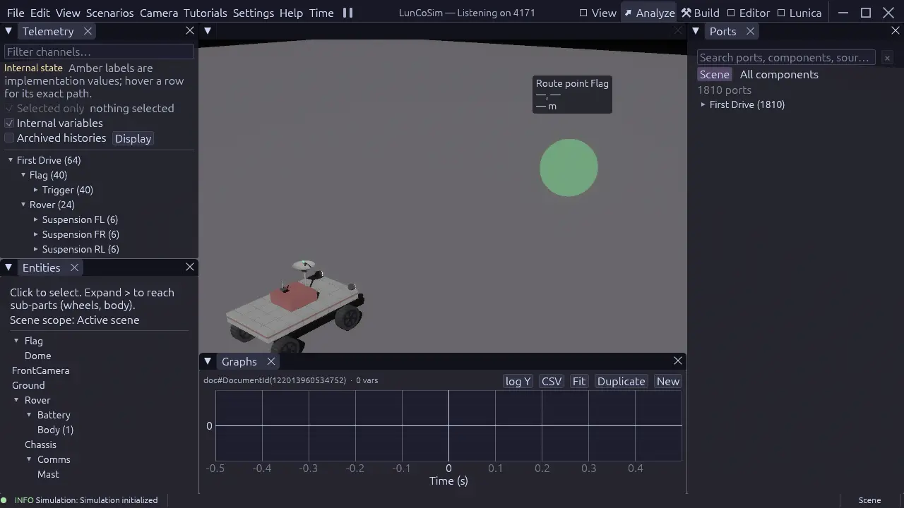

# Telemetry

Telemetry is a first-class runtime surface. Read it from the **Analyze**
perspective or from the HTTP API. Do not tail a log or poll a screenshot for a
number that the port registry already publishes.

Telemetry answers three different questions, and they should not be confused:

| Question | Read |
|---|---|
| What is exposed at the wiring boundary? | `ReadPorts` or the Telemetry panel |
| What does the Modelica solver currently hold? | `SnapshotVariables` |
| Is the end-to-end `Modelica → physics` chain healthy? | `CosimStatus` |

## In the window

1. Switch to **Analyze**.
2. Open **Telemetry**. It lists the live port-bearing entities and their
   channels.
3. Select an entity to see its current values. An absent port is not a zero;
   the entity may still be preparing.
4. Open **Graphs** and add a channel to see it over time. This is the right tool
   for settling, oscillation, and arrival checks.
5. Use **Ports** to inspect the resolved direction and kind of each port before
   wiring a target.

The graph records real simulation samples. It is not a render-frame animation.
When the world is paused, the last sample stays visible. Pausing does not
rewind, interpolate, or replay rendered frames.

<figure class="shot">
<a href="../../assets/images/screenshots/perspective-analyze.webp"></a>
<figcaption>The Analyze perspective brings Telemetry, Ports, and Graphs together. Select a channel in Telemetry to plot its samples in Graphs.</figcaption>
</figure>

A port's direction is part of its contract. Write inputs; read outputs. A value
that appears in the inspector is not necessarily a value that another model may
write. If a wiring target rejects a connection, inspect the resolved direction
and kind first.

## From the HTTP API

Start LunCoSim with an explicit port:

```bash
luncosim --api 4101
```

Find an entity:

```bash
PORT=4101

curl -s "http://127.0.0.1:$PORT/api/commands" \
  -H "Content-Type: application/json" \
  -d '{"type": "ListEntities"}'
```

The response contains each entity's `api_id`. Use that identity for reads:

```bash
# Discover the port names first; ReadPorts requires explicit names.
curl -s "http://127.0.0.1:$PORT/api/commands" \
  -H "Content-Type: application/json" \
  -d '{"type": "ExecuteCommand", "command": "ListPorts",
       "params": {"api_id": 42}}'

curl -s "http://127.0.0.1:$PORT/api/commands" \
  -H "Content-Type: application/json" \
  -d '{"type": "ExecuteCommand", "command": "ReadPorts",
       "params": {"api_id": 42,
                  "port_names": ["throttle", "steer", "speed"]}}'
```

`ReadPorts` returns the selected rows for one entity. It does not dump every
port; name what you need. Use `ReadPortsBatch` when you need one shared
`sim_tick` across several entities.

The request envelope, discovery endpoint, and error shape are documented in
[HTTP API](../reference/http-api.md).

## Modelica state

A rendered port is not necessarily the whole solver state. To inspect the
Modelica side:

```bash
curl -s "http://127.0.0.1:$PORT/api/commands" \
  -H "Content-Type: application/json" \
  -d '{"type": "ExecuteCommand", "command": "SnapshotVariables",
       "params": {"api_id": 42}}'
```

`SnapshotVariables` answers "what does the model currently hold?" Use
`ReadPorts` for "what is exposed at the wiring boundary?" and `CosimStatus` for
the end-to-end `Modelica → physics` chain.

## Readiness matters

Before treating a value as final, check readiness:

```bash
curl -s "http://127.0.0.1:$PORT/api/ready"
```

Require:

- `ready: true`
- `world_hold: false`
- `pending_count: 0`

A port may be momentarily absent while its model is compiling or its scene is
still being admitted. That is different from a valid zero. A required-data hold
keeps the world held even when the window is responsive; dismissing the
preparation window does not release that hold.

## Screenshots

Numbers answer "what value?" A screenshot answers "does the scene look right?"
Capture the visible production window, not a headless substitute:

```bash
curl -s "http://127.0.0.1:$PORT/api/commands" \
  -H "Content-Type: application/json" \
  -d '{"type": "ExecuteCommand", "command": "CaptureScreenshot",
       "params": {"save_to_file": true, "path": "target/telemetry-check.png"}}'
```

The path is relative to the process working directory. Read the resulting PNG
before reporting a visual result.

## Recording evidence

A useful telemetry check has three parts:

1. **Readiness.** Record `ready`, `world_hold`, and `pending_count` at the time
   of the read.
2. **Identity.** Record the entity `api_id`, the exact port names, and the
   `sim_tick` or batch tick that produced the values.
3. **Trend.** Use a graph or a series of reads for settling, oscillation, or
   arrival. A single sample is not a trend.

For an operator lifecycle, see
[Mission control](../reference/mission-control.md). For turning a live
value into a repeatable check, see
[Validation](../reference/validation.md).

## Common traps

| Trap | Better read |
|---|---|
| Polling stdout for a value | `ReadPorts` or the Telemetry panel |
| Treating a missing port as `0.0` | Check readiness and `ListPorts` |
| Using a single sample for a trend | Record a graph or a time series |
| Reading a render FPS as simulation cadence | Inspect the clock and timing profile |
| Comparing values from different ticks | Use one `ReadPorts` or `ReadPortsBatch` response |
| Looking only at ports for solver state | Also call `SnapshotVariables` |
| Treating a dismissed preparation window as released hold | Check `world_hold` and the required-data state |
| Using a headless screenshot as visual evidence | Capture the visible production window |

Continue with [HTTP API](../reference/http-api.md) for the request envelope, or
[Analyze](../general/perspectives.md#analyze-read-the-signals) for the
perspective that arranges Telemetry, Ports, and Graphs.
