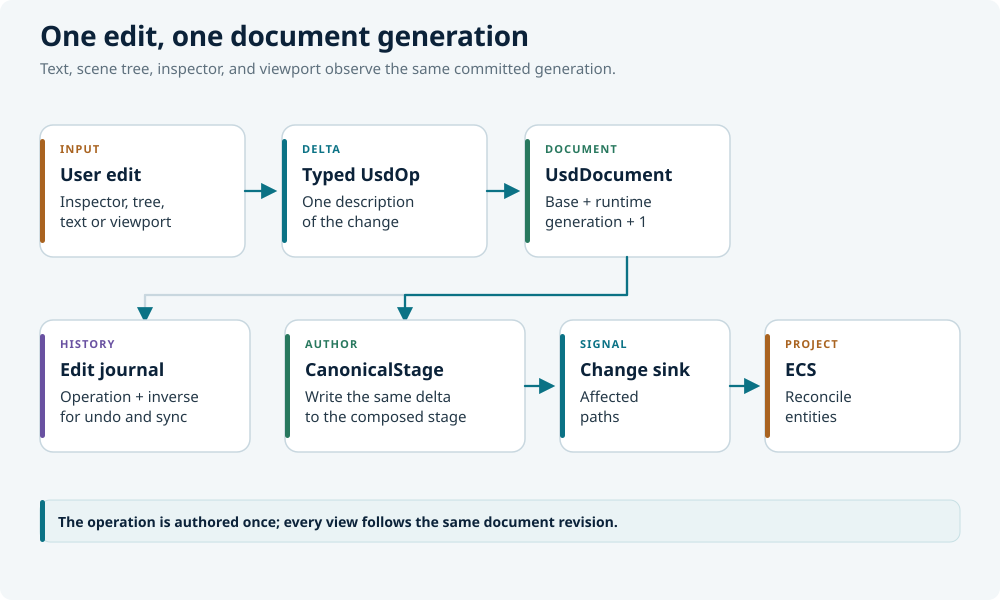

# Authoring

LunCoSim has two USD authoring surfaces and one document model behind both.
**Build** composes the live world from assemblies and entities. **Editor** opens
one explicit USD document and edits its internals. Neither surface writes text
behind the document's back.

## Build and Editor

| Perspective | Scope | Use it for |
|---|---|---|
| **Build** | The composed live scene | Placing assemblies, moving objects, environment settings, spawn catalog |
| **Editor** | One explicit USD document | Reusable assembly internals, prim hierarchy, materials, authored properties |

Build edits the live scene, so the simulation keeps running while you work. It
is the right place to compose a world from existing assets and to adjust
placement. Editor opens a file as an editing preview; it does not replace the
running scene.

The split matters because a composed scene and a reusable asset are different
authoring problems. A change to the practice yard's rover placement belongs to
the yard. A change to the rover's wheel mount belongs to the rover asset, where
every instance sees it.

## The document model

Every edit is a typed operation on a `UsdDocument`:

<figure class="diagram">
  
  <figcaption>The same typed operation feeds undo and sync, stage authoring, and entity reconciliation.</figcaption>
</figure>

The operation is the single description of the delta. Views do not re-derive
it by reading state back. This is the *author-once coherence* invariant: the
text editor, the scene tree, the property inspector, and the 3D viewport all
observe the same document generation.

The current operation set includes:

| Operation | Effect |
|---|---|
| `ReplaceSource` | Replace a whole layer's text |
| `AddPrim` | Add a prim, optionally with a reference |
| `RemovePrim` / `RestorePrim` | Remove or restore a subtree |
| `MovePrim` | Rename or reparent |
| `SetTranslate` / `SetRotate` | Set a transform |
| `SetAttribute` / `RemoveAttribute` | Author or remove a property |
| `MoveProperty` / `CopyProperty` | Rename or copy a property spec |
| `SetRelationship` | Set a relationship target list |
| `SetConnection` | Author a dataflow edge |
| `SetTimeSample` / `RemoveTimeSample` | Author animation |

Programmatic and UI edits go through `ApplyUsdOp` or `ApplyUsdOps`. Both return
a generation acknowledgement. Direct source mutation is out.

Multi-op intents use one change set. `AttachProgram` is the typed source-backed
program authoring intent; it lowers its complete source, port, and wire
contract to the same USD operation path.

## Layers and save semantics

The document has three layers:

- **base** — saved to the source file;
- **runtime** — durable edits kept out of the source file;
- **view** — disposable derived presentation.

Saving the document publishes the exported base bytes to the document's
existing asset identity before acknowledging success. Later reference
composition therefore sees the same bytes that are on disk.

The runtime layer is persisted only when the Twin opts in with
`usd.runtime_persistence = true`. The view layer is never saved, journaled, or
included in the sidecar. Route ribbons and visited-marker colors disappear when
the document closes.

Undo and redo are journal operations. Removing a prim captures only its
authored SDF subtree and the owning parent's sibling order, so undo does not
serialize the entire layer. Sibling order merges against the current parent
list, retaining unrelated later children.

## The Editor workflow

1. Choose a USD file in **Twin**, or use **File → Open**. The file opens as an
   editing preview.
2. Select a prim in **Prims** or click it in the preview. **Inspector** shows
   its properties.
3. Edit in the Inspector, or switch between **Visual** and **Text**.
4. Use the viewport transform gizmo for placement. Left-drag pans, right-drag
   orbits, the wheel zooms.
5. Review the journal in **Change History**. **Save** and **Undo** apply to the
   active document, not to the live scene.

To find a prim's file in the Twin browser, right-click the prim and choose
**Reveal in Twin**.

The text panel borrows a generation-matched authored or composed snapshot. It
does not create a preview-state transition, and painting it must not wake
render-layer reconciliation. Text-layer and mode changes use typed intents.

## Assembly authoring

The reusable `assembly_edit` tool owns explicit-document USD editing. Its
operations include:

- `add_prim`, `transform`, `attribute`, `schema`, `variant`, `relationship`,
  `connection`, and `batch`;
- `attach_component` and `detach_component`;
- `attach_program`;
- `rigid_body_plan`, `revolute_joint_plan`, `program_input_*`, and
  `program_output` constructors.

The higher-level `assembly_builder` tool provides semantic frame and shape
construction, placement, geometry, retrofit-body, reference-target, and
alignment plans. Both are policy wrappers over the journaled command surface.
USD remains the scene and topology authority; Modelica remains the equation and
graph authority.

The normal sequence is:

```rhai
let context = model_authoring::model_context(doc, root, "@root@");
let ready = model_authoring::readiness_report(doc, root, "@root@", policy);
let recipe = model_authoring::scene_recipe(doc, "@root@", scene, context.generation);
let graph = model_authoring::port_graph(doc, root, "@root@");
let wires = model_authoring::wiring_plan(
    doc, "@root@", root, connections, context.generation);
```

`model_context` is one composed, path-addressed read: children, references,
variants, component and frame facts, bodies, joints, colliders, ports,
generation, and available actions. `readiness_report` returns stable checks for
topology, physicality, mounts, connections, controls, and runtime evidence. An
omitted check is `not_requested`; it is not an implicit pass.

After review, apply the operations through `assembly_edit::batch` or the normal
proposal/review/commit flow, then re-read the new generation. Do not write USDA
text directly.

## References and variants

Use references for reusable assets. A reference composes the asset's prim tree
under the instance; an override changes only the opinions that differ.

```usda
def Xform "RoverA" (
    prepend references = @lunco://vessels/rovers/skid_rover.usda@
)
{
    double3 xformOp:translate = (0, 0, 0)
    uniform token[] xformOpOrder = ["xformOp:translate"]
}
```

Use variants for authored alternatives, not for runtime state. A variant
selection is an authored opinion and enters the journal.

## Programs and ports

`AttachProgram` authors a `LunCoProgramAPI` child, declared scalar ports,
defaults, and connections as one change set. The program is a child prim, so
deleting the owner deletes the behavior.

A model output becomes externally connectable only when the component prim
declares the matching `outputs:<name>` property. Declare every value another
component consumes, then verify that the generated network exposes it and the
composed source connection resolves to it.

See [Programs](programs.md) and
[Ports and connections](ports-and-connections.md).

## Validation while authoring

The lightest useful checks are:

| Question | Tool |
|---|---|
| Does the document parse and compose? | `ValidateAsset`, `luncosim --validate` |
| Is the loaded scene structurally sound? | `RunLint { scope: "scene" }` |
| Does the Twin resolve its names and assets? | `ValidateTwin` |
| Does the behavior meet its verdict? | `luncosim test --scene` |

A clean parse does not prove a clean run. Keep the evidence with the project.
See [Validation](../reference/validation.md).

## External tools

USD is an interchange format. Blender, Omniverse, USDView, and other tools can
open the same files. LunCoSim-specific facts live in standard schemas where
possible and in `lunco:` properties where the engine needs them.

A round trip through an external tool must preserve the standard schemas and
relationships. If a tool drops a `lunco:` property, the scene may still render
but lose a behavior. Keep a validation step after any external edit.

## Rules of thumb

- Use Build for placement, Editor for asset internals.
- Author one typed operation at a time; let the journal record it.
- Save through the document, not by rewriting text.
- Keep durable edits in the runtime layer only when they should not touch the
  source file.
- Treat the view layer as disposable.
- Re-read the document generation after a batch of edits.
- Validate before sharing a Twin.

The reference chapter documents the exact command-line and file-format
contracts: [Reference](../reference/index.md).
