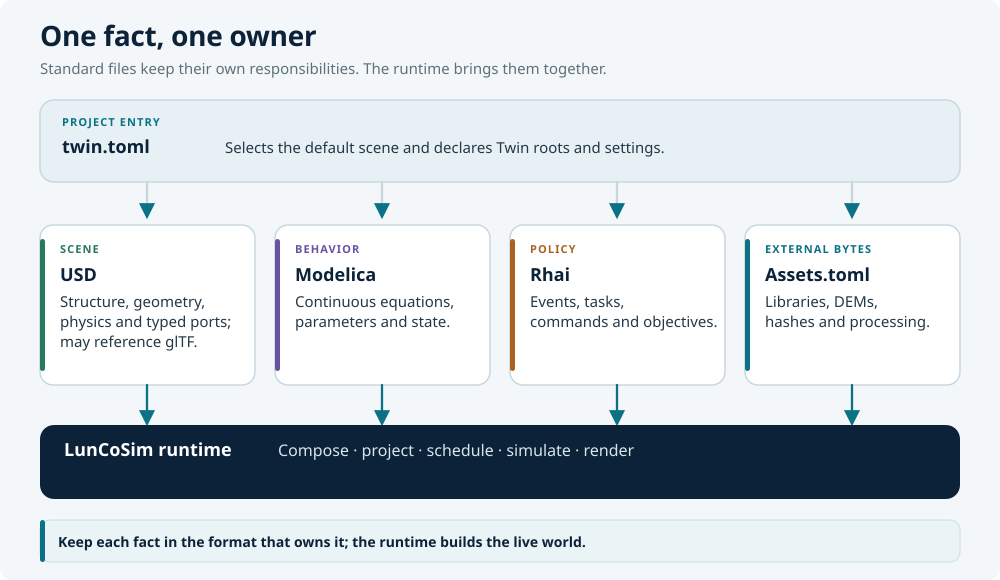

# Composition

A USD **stage** is the resolved result of one root layer plus every layer it
pulls in. Composition is the mechanism that lets a small, readable scene
describe a large, reusable world: a rover is authored once, referenced many
times, and varied per placement without copying its prim tree.

LunCoSim does not add a second composition system. It uses OpenUSD's resolver
and then projects the composed stage into the runtime. The rules in this
section are therefore USD rules first and LunCoSim rules second.

## The root layer and the stage

The organizing unit in USD is a single **root layer** (`.usd`, `.usda`, or
`.usdc`). Opening one file and resolving its composition arcs produces the
stage. Core USD has no project-level entry point: it cannot decide which file
in a folder is "the scene."

LunCoSim fills that gap with `twin.toml`:

```toml
[usd]
default_scene = "scene.usda"
```

`default_scene` is a Twin-relative path. It is the only way a Twin selects its
starting scene. The manifest points *at* a USD root; the root owns composition.
Do not grow the manifest into a scene description.

| Open entry point | What becomes the active stage |
|---|---|
| **Open Twin** with `default_scene` | That exact stage |
| **Open Twin** without `default_scene` | None; the viewport explains that no scene was selected |
| **Open Folder** without a manifest | None; clicking a USD file opens an isolated preview |
| **Open Scene** (loose USD file) | That file, after its owning folder is opened as a folder Twin |

Other `.usda` files in a Twin remain a referenceable library. They are indexed
and shown in the browser but are not mounted automatically.

## Composition arcs

| Arc | Authored as | Effect |
|---|---|---|
| **Sublayer** | `subLayers = [@lighting.usda@]` | Adds another layer at a defined strength in the same prim hierarchy |
| **Reference** | `prepend references = @rover.usda@` | Composes another layer's prim tree under this prim |
| **Payload** | `prepend payload = @terrain.usda@` | A loadable reference; may be unloaded until needed |
| **Variant** | `variants = { string look = "dusty" }` | Selects one of several authored opinions |
| **Inherit** | `inherits = </_BaseRover>` | Applies a class prim's opinions to this prim |
| **Specialize** | `specializes = </_BaseRover>` | Applies fallback opinions weaker than the local stack |

The composed stage resolves all of these before the runtime sees a prim. A
query such as `QueryUsdPrim` reads the composed result, not the root layer's
text. That is why a property authored in a referenced asset is visible on the
instance, and why an override on the instance wins.

### Reference or payload?

Use a **reference** when the asset is part of the scene's identity and should
load with it. Use a **payload** when the asset is large or optional and the
scene can be meaningful before it arrives. Terrain and high-resolution props
are typical payload candidates.

LunCoSim's loader treats a missing reference or payload as a missing
composition arc. It publishes the available stage, leaves the arc unresolved
as OpenUSD requires, and records a scene-scoped warning naming both the
referring layer and the dependency.

### Variants

Variants are the correct way to offer alternate geometry, materials, or
configuration without duplicating the prim tree:

```usda
def Xform "Rover" (
    prepend references = @lunco://vessels/rovers/skid_rover.usda@
    variants = {
        string wheel_set = "physical"
    }
    prepend variantSets = "wheel_set"
)
{
    variantSet "wheel_set" = {
        "raycast" {
            over "Chassis" { uniform token lunco:wheelType = "raycast" }
        }
        "physical" {
            over "Chassis" { uniform token lunco:wheelType = "physical" }
        }
    }
}
```

A variant selection is an authored opinion like any other. Changing it is a
USD edit and enters the journal; it is not a hidden runtime toggle.

## The live document layers

The authored stage a user edits is a `UsdDocument` with three layers. They
compose in this order:

```text
view   (weakest authored layer, disposable)
runtime (durable document edits, kept out of the source file)
base   (the source file)
```

The diagram below places USD in the larger layer model:

<figure markdown="span">
  <a href="../assets/images/luncosim-layers.svg">
    
  </a>
  <figcaption>USD owns the composed scene; the manifest, Modelica, Rhai, and the runtime own the surrounding layers.</figcaption>
</figure>

The **base** layer is saved to the source file. The **runtime** layer holds
durable edits that should survive a reload without rewriting the authored
source; a Twin can persist it under `.lunco/runtime/<scene-path>` by setting
`usd.runtime_persistence = true`. The **view** layer holds derived
presentation such as route ribbons and visited-marker colors. It is never
saved, journaled, or included in the runtime sidecar.

Composition happens once, on the `CanonicalStage`. Edits do not re-flatten the
scene; the typed operation is replayed onto the live stage, which fires the
change sink and reconciles the affected ECS entities. A full reload rebuilds
the stage from the composed source.

## Scene resolution in practice

The runtime never guesses a scene from a folder of files. The resolution rule
is:

1. The Twin manifest is parsed and `twin://` is mounted.
2. The authored `twin.lifecycle` policy selects the declared `default_scene`
   or clears the viewport.
3. The typed `OpenTwinScene` command validates the indexed path and loads it
   through the document-first `twin://` path.
4. The scene loads as a single root under the Grid. Loading another scene
   re-points that root; it never stacks scenes.

A plain folder has no manifest-backed scene selection. Clicking a USD file
opens its document through `OpenFile` and focuses an isolated preview lease
without replacing the running scene. A loose file opened from outside a Twin
resolves its owning folder, scans it, and enters the same folder-Twin path.

## Partial composition

A scene with a missing sublayer, reference, or payload does not discard the
siblings that did resolve. After structural projection settles, the loader
reports the ordered missing `{referring_layer, dependency}` pairs to the
`usd.scene_composition` policy.

The shipped policy chooses `allow_partial`, which preserves the available
stage. A Twin can replace that decision with `reject_scene`. Rejection tears
down a partial initial stage and fails the transition; for a dynamic reference
it faults and holds simulation while leaving the reference unprojected.

A complete closure does not call the policy. Failures that are not missing
files — unsafe traversal, permission errors, malformed required input, or
exceeded closure limits — remain visible and terminal at their owner. The
loader never rewrites a stale authored URI to a different asset.

## Composition limits

The canonical asset resolver bounds the closure by layer count, dependency
width, depth, retained bytes, and concurrent reads. Independent branches are
read in bounded parallel batches, and results are applied in authored
dependency order. This keeps I/O completion order from changing the recipe.

On native, composition and prepared-plan extraction run on the async-compute
pool. The browser path composes on the main thread until a Web Worker
transport is available.

## Worked example

A Twin can keep a reusable rover and a practice yard in separate files:

```usda
#usda 1.0
(
    defaultPrim = "PracticeYard"
    upAxis = "Y"
    metersPerUnit = 1
    subLayers = [@lighting.usda@]
)

def Xform "PracticeYard"
{
    def Xform "RoverA" (
        prepend references = @assets/rovers/skid_rover.usda@
    )
    {
        double3 xformOp:translate = (0, 0, 0)
        uniform token[] xformOpOrder = ["xformOp:translate"]
    }

    def Xform "RoverB" (
        prepend references = @assets/rovers/skid_rover.usda@
    )
    {
        double3 xformOp:translate = (8, 0, 4)
        uniform token[] xformOpOrder = ["xformOp:translate"]
    }
}
```

Both rovers share one source asset. Moving `RoverB` authors an override on the
instance, not a second copy of the rover. Editing `skid_rover.usda` affects both
on the next composition, which is exactly the intended relationship between a
type and its instances.

## Rules of thumb

- Give every referenced asset a `defaultPrim`; give every stage an explicit
  `upAxis` and `metersPerUnit`.
- Reference reusable assets; override only the opinions that differ.
- Use variants for authored alternatives, not for runtime state.
- Keep `default_scene` a path. Let the USD root own composition.
- Do not use `..` to escape an asset root. Use `twin://` or `lunco://`.
- Treat a missing arc as a visible composition fact, not as an empty scene.
- Save authored changes through the document journal; do not rewrite USDA text
  from a script.

The next section turns the composed hierarchy into a physical world:
[Physics](physics.md).
